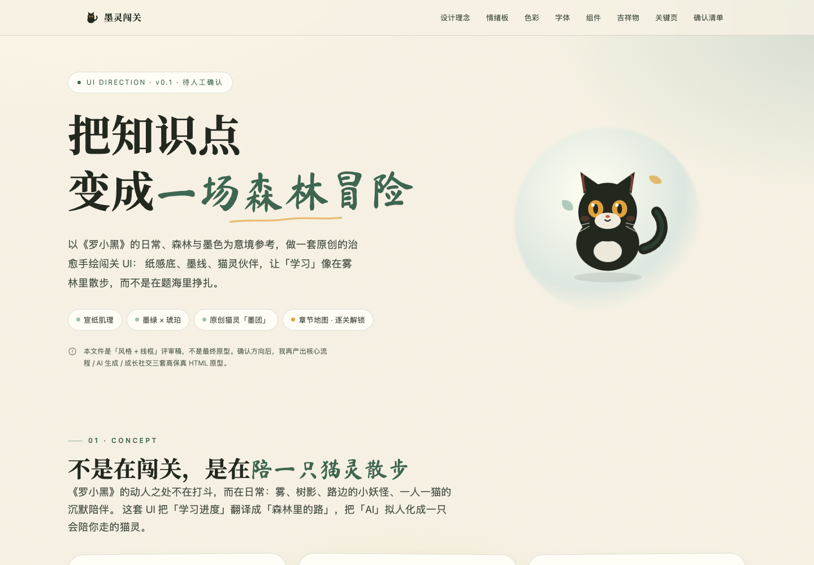

# 墨灵闯关 · AI 出题学习助手

> 输入一个知识点 → AI 联网检索并出题 → 闯关答题 → 生成学习诊断报告。
> 把「枯燥的被动阅读」变成「有反馈的主动回忆」。

[](https://github.com/Light-ux-source/moling-quest)
[](#测试)
[](docs/02-UI设计规范.md)

一套代码两端运行：**微信小程序 + H5**。没有 DeepSeek API Key 也能用 Mock 模式完整演示。

## 现在到哪一步

| 维度 | 状态 |
| --- | --- |
| 核心链路 | ✅ 已跑通（输入 → 出题 → 答题 → 判分 → 报告），pytest 8 项通过 |
| 小程序端 | ✅ 3 页功能验证版（输入/答题/报告） |
| 已确认 UI | 🎨 13 页纸感方案全案通过，待 Taro 落地 |
| 真实模型 | ⏳ 代码就绪，待填入 API Key 联调 |
| 上线合规 | ⏳ 登录、配额、内容审核、备案待做 |

## 快速开始

### 1. 启动后端

```bash
cd backend
python3 -m venv .venv
.venv/bin/pip install -r requirements.txt
cp .env.example .env            # 可留空，默认走 Mock
.venv/bin/uvicorn app.main:app --reload --port 8000
```

- 接口文档：http://127.0.0.1:8000/docs
- 健康检查：http://127.0.0.1:8000/api/v1/health （返回 `mode: mock | deepseek`）

**接入真实 AI**：在 `backend/.env` 填入

```bash
DEEPSEEK_API_KEY=sk-xxxxxxxx
LLM_PROVIDER=deepseek
```

### 2. 启动小程序端

```bash
cd miniapp
npm install
npm run build:weapp   # 产物 dist/
npm run dev:weapp     # 开发模式（watch）
npm run build:h5      # 产物 dist-h5/
npm run dev:h5        # H5 调试，默认 http://127.0.0.1:10086
```

用微信开发者工具导入 `miniapp/` 目录（`project.config.json` 已指向 `dist/`，AppID 为测试号占位）。本地联调需勾选「不校验合法域名…」。

API 地址在 `miniapp/src/config.ts`，默认 `http://127.0.0.1:8000`；生产构建时注入：

```bash
TARO_APP_API_BASE=https://api.your-domain.com npm run build:weapp
```

## UI 设计（已通过评审）

**治愈手绘 · 宣纸 · 墨线 · 森林晨雾 · 原创猫灵「墨团」**，不使用《罗小黑》官方素材。

| 项 | 内容 |
| --- | --- |
| 主色 | 苔绿 `#3E6650` |
| 强调 | 琥珀 `#E0A23C`（当前关/经验/猫瞳） |
| 背景 | 宣纸 `#F7F2E4` / 素笺 `#FFFDF6` |
| 标题 / 正文 | 毛笔体 / 宋体（均有系统回退） |

- [风格板](prototype/00-style-guide.html)（色板、组件、吉祥物、动效 + 2 页高保真）
- [13 页线框](prototype/01-wireframes.html)（一行三列、响应式）
- [UI 设计规范](docs/02-UI设计规范.md) · [页面设计说明](docs/03-页面设计说明.md)



**页面结构**：首页 → 章节地图 → 答题 → 结算 → 报告；AI 造关（输入/生成中/预览）与错题本；成长线（成就/个人中心/分享/排行榜）。

## 文档

文档中心：[docs/README.md](docs/README.md)（单一事实来源）

| 文档 | 内容 |
| --- | --- |
| [01-需求规格说明书](docs/01-需求规格说明书.md) | 15 条功能需求、10 条非功能需求、验收场景、追踪矩阵 |
| [02-UI设计规范](docs/02-UI设计规范.md) | 色彩/字体/组件/吉祥物/动效/无障碍/设计令牌 |
| [03-页面设计说明](docs/03-页面设计说明.md) | 13 页逐页目标、布局、状态、文案、接口对照 |
| [04-ADR决策记录](docs/04-ADR决策记录.md) | 15 条关键决策的原因、代价与重审条件 |
| [05-测试与验收报告](docs/05-测试与验收报告.md) | 当前质量快照、已知限制、复现命令 |
| [06-协作与发布指南](docs/06-协作与发布指南.md) | 分支、门禁、发布、文档维护 |
| [方案设计文档](方案设计文档.md) | 技术选型、架构、数据模型、接口、AI 工程、部署 |
| [CHANGELOG](CHANGELOG.md) | 版本变更 |

## 技术栈

| 层 | 选型 |
| --- | --- |
| 小程序端 | Taro 4.3.2 + React 18 + TypeScript |
| 后端 | Python 3.9+ / FastAPI + Uvicorn |
| AI | DeepSeek `deepseek-flash`（JSON Output，默认关闭思考） |
| 检索 | DeepSeek Search API（`/v1/tools/search`） |
| 存储 | SQLite（WAL），仓储层隔离，可迁 PostgreSQL |

选型对比见 [方案设计文档](方案设计文档.md) 第 3 章。

## 测试

```bash
# 后端单测 + 接口测试（8 个用例，Mock 模式）
cd backend && .venv/bin/python -m pytest -q

# 前端类型检查与构建
cd miniapp && npx tsc --noEmit && npm run build:weapp && npm run build:h5

# H5 端到端（需后端 8000 + 静态服务 10087）
cd miniapp && python3 scripts/serve_h5.py dist-h5 10087 &
node scripts/e2e.js
```

## 目录结构

```
backend/            FastAPI：检索→提纲→出题→判分→报告
  app/services/     出题、判分、报告
  tests/            pytest
miniapp/            Taro 小程序 / H5
  src/pages/        当前 3 页功能版
  src/services/     请求、轮询、本地缓存
prototype/          已确认的 UI 风格板与 13 页线框
docs/               需求、UI、页面、ADR、测试、协作
shots/              H5 验收截图
CHANGELOG.md
```

## 已实现

- 输入主题、难度、题量、题型
- 检索 → 提纲 → 出题，四题型（单选/多选/判断/简答）
- 异步任务 + 轮询 + 分步进度
- 客观题规则判分、简答题 rubric 判分（失败降级）
- 报告：分数、分题型统计、逐题解析、知识缺口、下一步、建议主题、来源
- 失败重试、未答确认、重复提交拦截、限流
- Mock 模式、token/成本统计

## 尚未实现

- 13 页新 UI 的 Taro 实现（见 [页面设计说明](docs/03-页面设计说明.md) 第 7 节）
- 登录与跨端同步、用户配额、内容审核
- 错题本、成就、分享、排行榜（P1/P2）
- 多轮追问、指定信息源（P1）

## 注意

- 生产环境必须使用 HTTPS 已备案域名，并在微信公众平台配置 request 合法域名。
- `backend/.env` 含密钥，不要提交到仓库或前端。
- 内容由 AI 生成，上线前需补充 AI 生成标识、内容审核与免责声明。
- 本项目为原创视觉，不包含《罗小黑战记》官方角色、剧照或 Logo，不构成联名或授权关系。