# 墨灵闯关 · AI 出题学习助手

> 输入一个知识点 → AI 联网检索并出题 → 闯关答题 → 生成学习诊断报告。
>
> 把「枯燥的被动阅读」变成「有反馈的主动回忆」。

[](#测试)
[](#界面)
[](https://docs.taro.zone/docs/GETTING-STARTED)
[](https://docs.langchain.com/oss/python/integrations/chat/deepseek)

一套代码两端运行：**微信小程序 + H5**。没有 DeepSeek API Key 也能用 Mock 模式完整演示。

## 现在到哪一步

| 维度 | 状态 |
| --- | --- |
| 核心链路 | ✅ 输入 → 检索 → 出题 → 答题 → 结算 → 报告 |
| 小程序端 | ✅ **S01–S08 + S11 个人中心/记录/设置/登录已落地** |
| 后端 | ✅ 章节/进度/结算/日挑战/章末综合/重试/账号/配额/个人中心/Tavily 联网/知识库 RAG，pytest **189 passed** |
| AI 编排 | ✅ LangChain 0.3.x（LCEL + ChatDeepSeek），Mock/真实同构 |
| 真实模型 | ✅ 阿里云 MaaS `deepseek-v4.1-flash-1017` + Tavily + `qwen3.7-text-embedding-flash` 已跑通真实 E2E：知识库 3 片段、3 题 ready、逐题 `source_refs` 为 `kb://` |
| 知识库 RAG | ✅ 文档/网页/文本入库、Qdrant、Agentic RAG、kb_only/hybrid、来源可追溯；详见 [22](docs/22-知识库与RAG实现.md) |
| 账号与数据 | ✅ 微信登录/体验登录、游客 1 组试用、3 组/日、昵称头像、积分、学习记录、注销；**MySQL 8+/9** |
| 微信配置 | ✅ AppID/AppSecret 已填写并加载，`/health.wechat_login=true`；真实 `wx.login` code 待真机走查 |
| 上线合规 | ⏳ S09–S13、真实 wx.login/真机、视频 ASR/OCR、内容审核、备案待做 |

## 界面

| 首页 | 章节地图 | 答题 |
| --- | --- | --- |
| 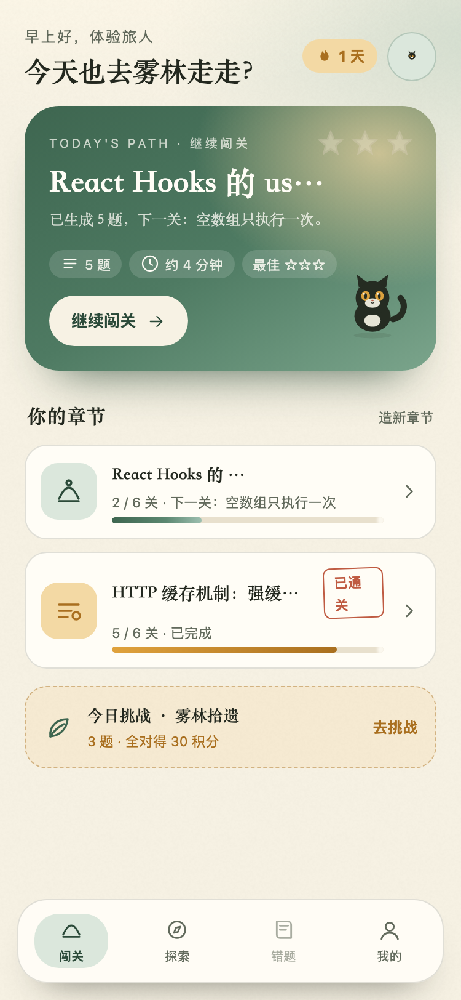 | 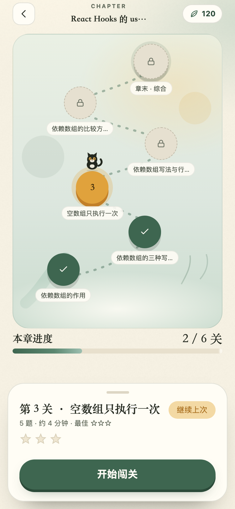 | 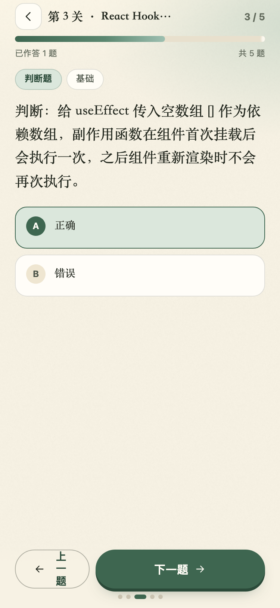 |

| 结算 | 报告 | 造关 |
| --- | --- | --- |
| 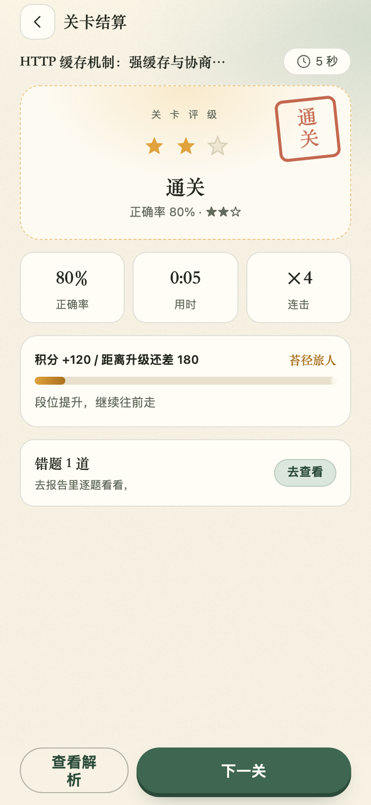 | 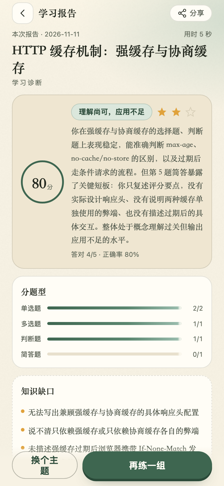 | 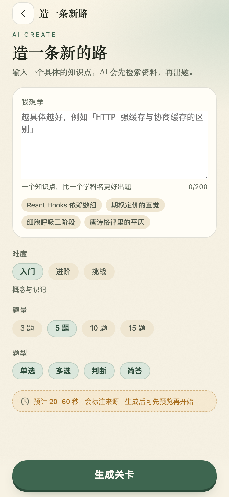 |

| 生成中 | 预览 |
| --- | --- |
| 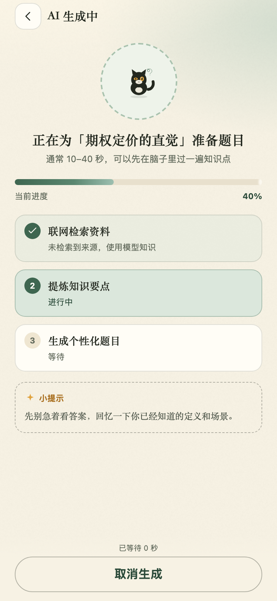 | 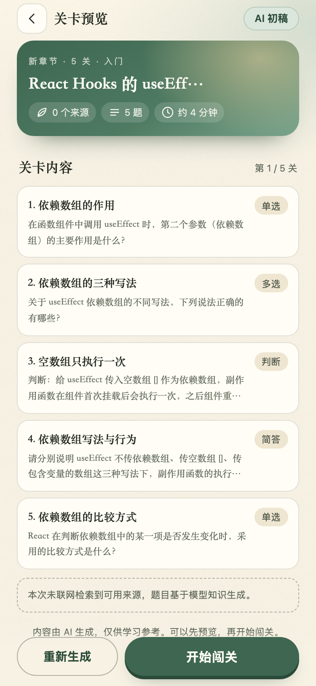 |

| 个人中心 | 学习记录 | 设置 |
| --- | --- | --- |
| 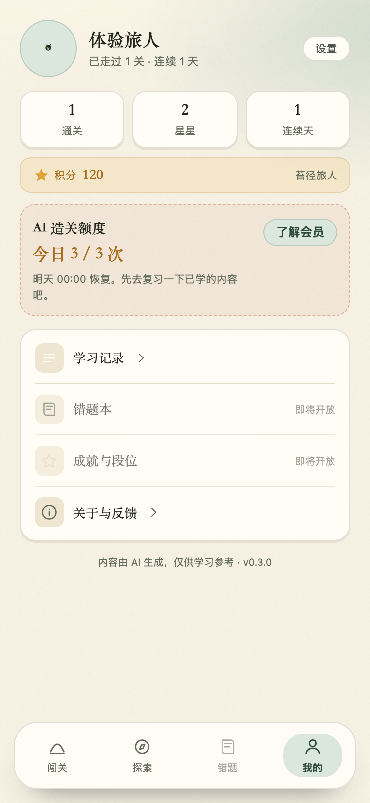 | 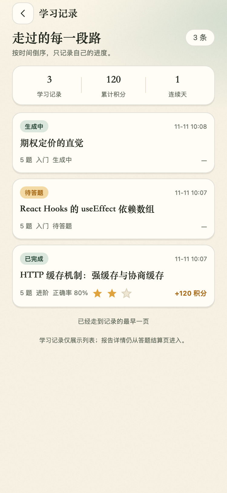 | 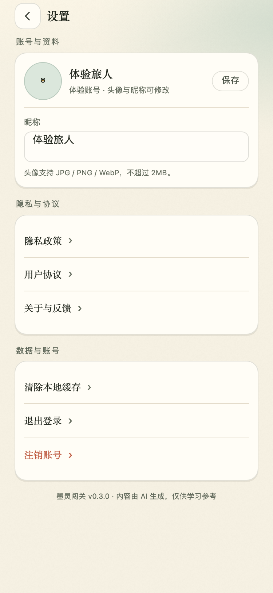 |

| 资料库 | 选库出题 |
| --- | --- |
| 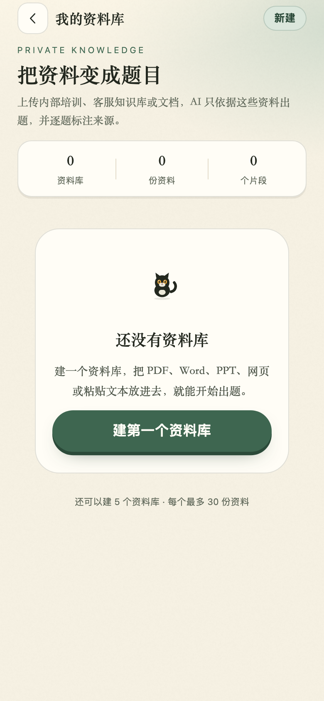 | 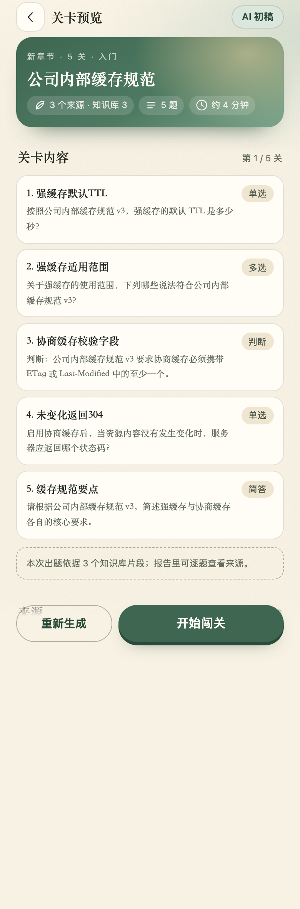 |

完整报告：[shots/report-full.png](shots/report-full.png)。

截图 375×812 @2x，来源 `miniapp/scripts/screenshot.js`；与 `prototype/` 已确认原型对照。

## 快速开始

### 1. 启动后端

```bash
cd backend
./scripts/start_mysql_dev.sh     # 独立 MySQL 3307，不碰系统 3306
python3 -m venv .venv
.venv/bin/pip install -r requirements.txt
cp .env.example .env            # 填 MYSQL_* / WECHAT_*；可留空 AI key 走 Mock
.venv/bin/uvicorn app.main:app --reload --port 8000
```

> 数据库已切换为 **MySQL 8+/9**。本地脚本会创建 `lwa_dev` / `lwa_test` 与用户 `lwa`；生产请配置 `MYSQL_*` 指向你的 MySQL，并先建 `utf8mb4` 库。旧 SQLite 文件不再读取。
>
> 环境变量模板：[`backend/.env.example`](backend/.env.example)（可提交/开源，不含真实密钥）；复制为 `backend/.env` 后填写 `WECHAT_APP_ID`、`WECHAT_APP_SECRET` 等。可用 `python3 scripts/check_env_example.py` 校验模板完整性与敏感项为空。

- 接口文档：http://127.0.0.1:8000/docs
- 健康检查：http://127.0.0.1:8000/api/v1/health （返回 `mode: mock | deepseek`）

**接入真实 AI**：编辑 `backend/.env`（已 gitignore）：

```bash
DEEPSEEK_API_KEY=sk-xxxxxxxx
LLM_PROVIDER=deepseek
DEEPSEEK_BASE_URL=https://api.deepseek.com
DEEPSEEK_MODEL=deepseek-v4.1-flash-1017
ENABLE_WEB_SEARCH=true
SEARCH_PROVIDER=tavily
TAVILY_API_KEY=tvly-xxxxxxxx
```

> 如果使用第三方 OpenAI 兼容网关（如阿里云 MaaS），Base URL 通常要写到 `/compatible-mode/v1`，模型名用网关提供的 ID（例如 `deepseek-v4.1-flash-1017`）；这类网关通常没有 DeepSeek 官方 Search API，联网检索由 **Tavily** 提供，与 Chat 网关解耦。Tavily Key 只放后端 `.env`，不要写进小程序。
>
> 没有 Tavily Key 时，可显式设 `SEARCH_PROVIDER=tavily` + `TAVILY_ALLOW_KEYLESS=true` 使用免费的 keyless 模式（限流，适合本地演示）；生产建议配置正式 Key。`SEARCH_PROVIDER=auto` 只在配置了 Tavily Key 时自动启用 Tavily，避免无 Key 环境偷偷联网。
>
> 知识库默认复用 `DEEPSEEK_*` 的 Base URL/Key 调用 `qwen3.7-text-embedding-flash`，Qdrant 使用 `backend/data/qdrant` 嵌入式模式；无 Key/Mock 时降级为哈希向量。完整配置见 [`backend/.env.example`](backend/.env.example) 与 [22-知识库与RAG实现](docs/22-知识库与RAG实现.md)。

### 2. 启动小程序端

```bash
cd miniapp
npm install
npm run build:weapp   # 产物 dist/
npm run dev:weapp     # 开发模式（watch）
npm run build:h5      # 产物 dist-h5/
npm run dev:h5        # H5 调试，默认 http://127.0.0.1:10086
```

用微信开发者工具导入 `miniapp/` 目录（`project.config.json` 已指向 `dist/`，AppID 为测试号占位）。本地联调需勾选「不校验合法域名…」。

API 地址在 `miniapp/src/config.ts`，默认 `http://127.0.0.1:8000`；生产构建时注入：

```bash
TARO_APP_API_BASE=https://api.your-domain.com npm run build:weapp
```

> H5 默认 hash 路由：直接访问页面用 `http://127.0.0.1:10087/#/pages/...`。

## UI 设计

**治愈手绘 · 宣纸 · 墨线 · 森林晨雾 · 原创猫灵「墨团」**，不使用《罗小黑》官方素材。

| 项 | 内容 |
| --- | --- |
| 主色 | 苔绿 `#3E6650` |
| 强调 | 琥珀 `#E0A23C`（当前关/经验/猫瞳） |
| 背景 | 宣纸 `#F7F2E4` / 素笺 `#FFFDF6` |
| 标题 / 正文 | 毛笔体 / 宋体（均有系统回退） |
| 组件 | 按钮、chip、选项、节点、星级、印章、抽屉、tabbar、墨团三姿态 |

- [风格板](prototype/00-style-guide.html) · [13 页线框](prototype/01-wireframes.html)
- [UI 设计规范](docs/02-UI设计规范.md) · [页面设计说明](docs/03-页面设计说明.md)

## 文档

文档中心：[docs/README.md](docs/README.md)（单一事实来源）。从「我想做什么」选入口：

| 我想… | 文档 |
| --- | --- |
| 2 分钟接手 | [00-交接摘要](docs/00-交接摘要.md) |
| 知道现在做到哪 | [05-测试与验收报告](docs/05-测试与验收报告.md) · [16-路线图与待办](docs/16-路线图与待办.md) |
| 看架构/代码在哪 | [08-系统架构与代码地图](docs/08-系统架构与代码地图.md) |
| 调接口 | [09-API接口手册](docs/09-API接口手册.md) |
| 改页面 | [03-页面设计说明](docs/03-页面设计说明.md) · [11-前端实现指南](docs/11-前端实现指南.md) |
| 改 Prompt/模型 | [12-AI工程与Prompt手册](docs/12-AI工程与Prompt手册.md) · [07-技术核实](docs/07-技术核实.md) |
| 跑测试/截图 | [13-测试手册](docs/13-测试手册.md) |
| 部署上线 | [14-部署与运维手册](docs/14-部署与运维手册.md) |
| 查报错 | [15-故障排查与FAQ](docs/15-故障排查与FAQ.md) |
| 找术语/文件 | [17-术语表与索引](docs/17-术语表与索引.md) |
| 看最终运行状态 | [20-最终交付与运行状态](docs/20-最终交付与运行状态.md) |
| 改/排查联网搜索 | [21-联网搜索实现与验收](docs/21-联网搜索实现与验收.md) |
| 改/排查知识库 RAG | [22-知识库与RAG实现](docs/22-知识库与RAG实现.md) |

完整清单：[需求规格](docs/01-需求规格说明书.md) · [UI 规范](docs/02-UI设计规范.md) · [页面说明](docs/03-页面设计说明.md) · [ADR](docs/04-ADR决策记录.md) · [测试报告](docs/05-测试与验收报告.md) · [协作发布](docs/06-协作与发布指南.md) · [技术核实](docs/07-技术核实.md) · [架构](docs/08-系统架构与代码地图.md) · [API](docs/09-API接口手册.md) · [数据模型](docs/10-数据模型与迁移.md) · [前端](docs/11-前端实现指南.md) · [AI](docs/12-AI工程与Prompt手册.md) · [测试](docs/13-测试手册.md) · [部署](docs/14-部署与运维手册.md) · [FAQ](docs/15-故障排查与FAQ.md) · [路线图](docs/16-路线图与待办.md) · [术语](docs/17-术语表与索引.md) · [用户系统需求](docs/18-用户系统需求分析.md) · [用户系统实现](docs/19-用户系统实现与验收.md) · [最终运行状态](docs/20-最终交付与运行状态.md) · [联网搜索](docs/21-联网搜索实现与验收.md) · [知识库RAG](docs/22-知识库与RAG实现.md) · [方案设计](方案设计文档.md) · [CHANGELOG](CHANGELOG.md)。

## 技术栈

| 层 | 选型 |
| --- | --- |
| 小程序端 | Taro 4.3.2 + React 18 + TypeScript（官方脚手架） |
| 后端 | Python 3.9+ / FastAPI + Uvicorn |
| AI | DeepSeek `deepseek-v4.1-flash-1017`（JSON Output，默认关闭思考；15 题分批生成） |
| Prompt 编排 | LangChain 0.3.x（`ChatPromptTemplate` + LCEL + `ChatDeepSeek`） |
| 检索 | Tavily Search API（`POST /search`，`search_depth=basic`，6 条结果）；保留 DeepSeek 官方 Search 适配 |
| 知识库 | Qdrant 1.16.1（本地嵌入式）+ `qwen3.7-text-embedding-flash`（1024 维）+ Agentic RAG |
| 存储 | **MySQL 8+/9**（PyMySQL，utf8mb4），仓储层隔离 |
| 测试 | pytest + Playwright（H5 E2E / 截图） |

选型对比见 [方案设计文档](方案设计文档.md) 第 3 章；LangChain/Taro 版本核实见 [docs/07](docs/07-技术核实.md)。

## 测试

```bash
# 环境变量模板校验（确保无真实密钥、必需项齐全）
python3 scripts/check_env_example.py

# 后端单测 + 接口测试（189 个用例，Mock 模式；含 RAG 解析/切片/向量/检索/知识库/会话集成）
cd backend && .venv/bin/python -m pytest -q

# 前端类型检查与构建
cd miniapp && npx tsc --noEmit && npm run build:weapp && npm run build:h5

# H5 端到端（需后端 8000 + 静态服务 10087）
cd miniapp && python3 scripts/serve_h5.py dist-h5 10087 &
node scripts/e2e.js

# 演示数据 + 视觉截图（MySQL + 体验登录）
../backend/.venv/bin/python scripts/seed_demo.py --reset
node scripts/screenshot.js
```

当前基线：**189 passed / tsc 通过 / weapp+h5 构建通过 / H5 E2E PASS（含游客→体验登录→个人中心→记录→造关→答题→结算→报告→资料库上传→选库出题；0 错误、0 4xx、375/390/768 无横向溢出）**。

真实模型单组实测（2026-11-09，阿里云 MaaS `deepseek-v4.1-flash-1017`）：tokens 约 2.9k in / 2.1k out（实测 2871/2072、2996/2176），估算成本 **¥0.022–0.023**；从创建到完成 15–20s（含作答），批改/报告约 3s。15 题实测：按 5 题一批共 3 批，34–38 秒生成满 15 题。联网检索由 Tavily 提供（2026-11 核实：`POST https://api.tavily.com/search`，Bearer 鉴权，`results[].content` 作为摘要注入 digest），会额外增加约 1 次搜索请求与少量 Prompt token。

## 目录结构

```
backend/            FastAPI：LangChain → 检索 → 提纲 → 出题 → 判分 → 报告
  app/chains/       Prompt 模板、ChatDeepSeek/MockChatModel、LCEL、解析
  app/rag/          分块、解析、embedding、Qdrant、Agentic 检索
  app/services/     question_gen / grading / reporting / chapters / settlement / auth / quota / kb / ingest
  tests/            pytest（189）
miniapp/            Taro 小程序 / H5
  src/pages/        S01–S08 + S11 个人中心 / 记录 / 设置 / 关于 / 资料库
  src/components/   设计系统组件
  src/styles/       tokens / components / noise
  src/assets/       SVG 图标、墨团、地图路径（gen_assets.py 生成）
  scripts/          e2e / screenshot / seed_demo / gen_assets / serve_h5
prototype/          已确认的 UI 风格板与 13 页线框
docs/               需求、UI、页面、ADR、测试、协作、技术核实
shots/              S01–S08 验收截图
```

## 已实现

- S01 首页：问候、连续天数、主卡、章节卡、今日挑战、tabbar
- S02 章节地图：6 节点三态、墨团、底部抽屉、章末综合
- S03 答题：一题一屏、选项/简答、圆点导航、未答确认、草稿恢复
- S04 结算：三星、印章、正确率/用时/连击、积分、段位、解锁
- S05 报告：分数、诊断、分题型、缺口、下一步、逐题解析、来源、再练
- S06 造关输入：200 字、示例、难度/题量/题型
- S07 生成中：三步真实进度、慢等待提示、失败重试、稍后回来
- S08 预览：章节卡、题目列表、来源、重新生成、开始闯关
- 后端：章节/进度/结算/日挑战/章末综合/失败重试/个人统计
- **用户系统**：微信一键登录（首次自动注册）/体验登录、登录态与退出、游客 1 组试用、登录 3 组/日、游客数据迁移、头像昵称填写、积分、学习记录列表、设置/隐私/注销（24h 冷却）
- **知识库 RAG**：资料库 CRUD、PDF/Word/PPT/Excel/TXT/MD/网页/文本入库、Qdrant 向量、Agentic RAG（规划/多查询/融合/充分性/改写）、kb_only/hybrid、逐题 `kb://` 引用、失败重试、注销清理
- **MySQL 8+/9**（PyMySQL）；`users/auth_tokens/user_settings/guest_trials` 等表；越权访问 404
- LangChain 0.3.x 编排四条 Prompt 链；JSON mode、思考开关、空 content 重试
- Mock/真实双模式、客户端隔离、限流、账号隔离

## 尚未实现

- S09 错题本、S10 成就、S12 分享、S13 排行榜（P1/P2）
- 真实 `wx.login` code / 微信真机登录与头像昵称填写走查（代码已实现，AppID/AppSecret 已配置）
- `msgSecCheck` 内容审核、备案、小程序码、多轮追问、视频 ASR/扫描件 OCR

## 注意

- 数据库为 MySQL；本地开发用 `backend/scripts/start_mysql_dev.sh`，生产配置 `MYSQL_*` 并先建库。
- 微信 `WECHAT_APP_ID` / `WECHAT_APP_SECRET` 已填写并重启；`/health` 的 `wechat_login=true`。真实登录还需开发者工具/真机的 `wx.login` code；开发/验收也可用“体验登录”。
- 生产环境必须使用 HTTPS 已备案域名，并在微信公众平台配置 request 合法域名。
- `backend/.env` 含密钥，不要提交到仓库或前端；如怀疑泄露请立即轮换。
- 内容由 AI 生成，上线前需补充 AI 生成标识、内容审核与免责声明。
- 本项目为原创视觉，不包含《罗小黑战记》官方角色、剧照或 Logo，不构成联名或授权关系。