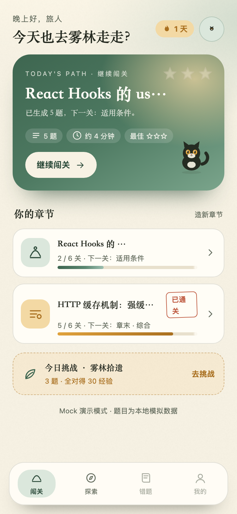
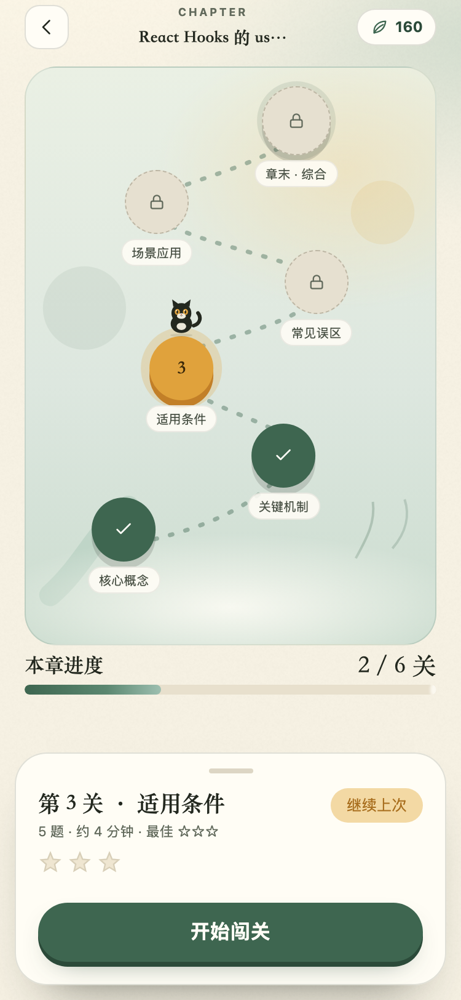
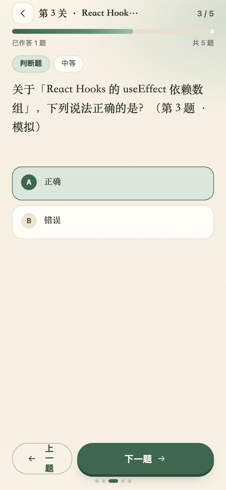
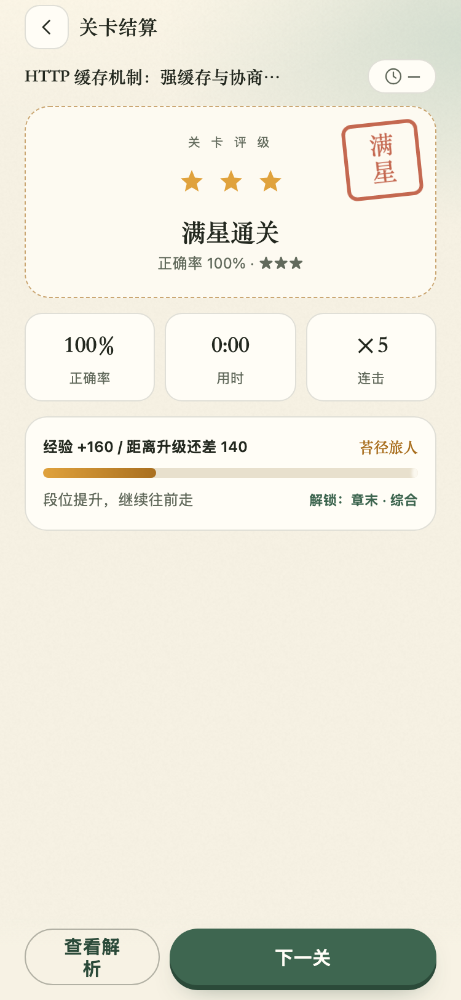
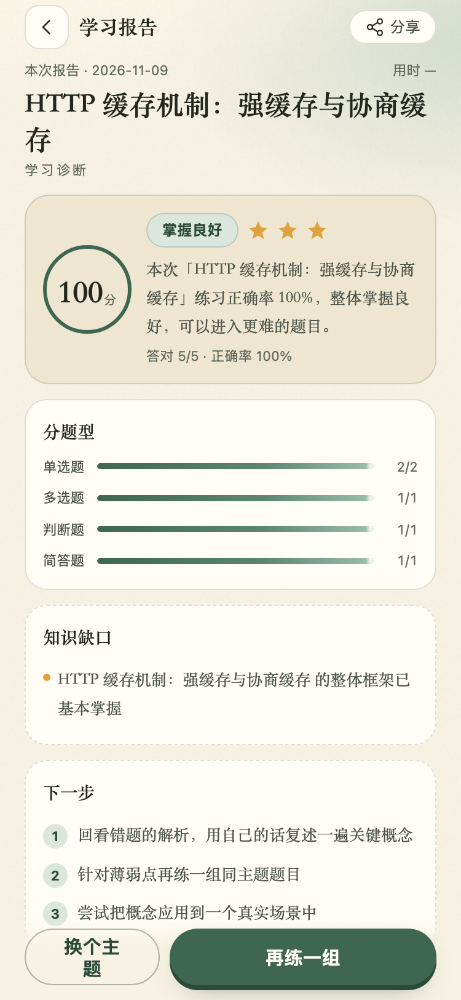
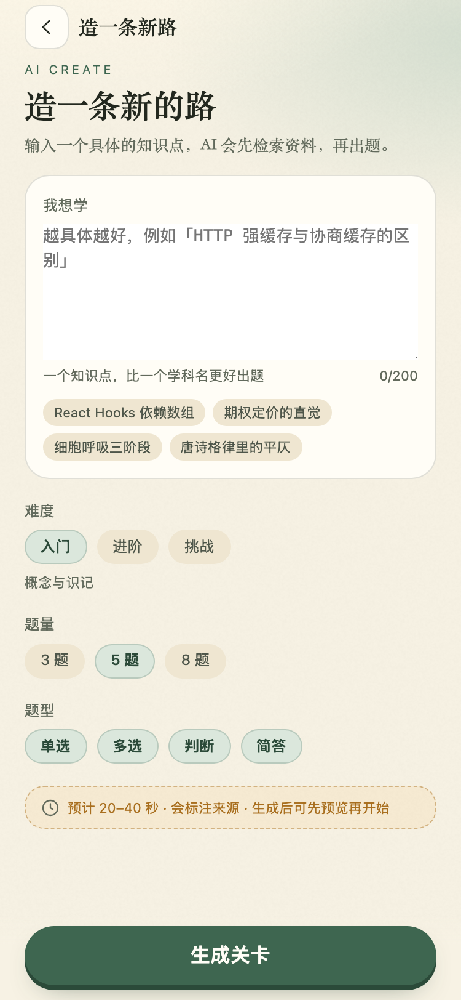
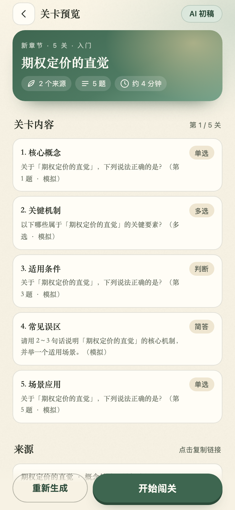
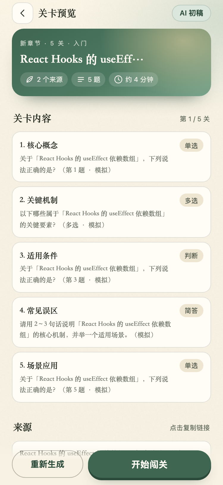

# 墨灵闯关 · AI 出题学习助手

> 输入一个知识点 → AI 联网检索并出题 → 闯关答题 → 生成学习诊断报告。
>
> 把「枯燥的被动阅读」变成「有反馈的主动回忆」。

[](#测试)
[](#界面)
[](https://docs.taro.zone/docs/GETTING-STARTED)
[](https://docs.langchain.com/oss/python/integrations/chat/deepseek)

一套代码两端运行：**微信小程序 + H5**。没有 DeepSeek API Key 也能用 Mock 模式完整演示。

## 现在到哪一步

| 维度 | 状态 |
| --- | --- |
| 核心链路 | ✅ 输入 → 检索 → 出题 → 答题 → 结算 → 报告 |
| 小程序端 | ✅ **S01–S08 已按已确认 UI 落地**（首页/地图/答题/结算/报告/造关/生成/预览） |
| 后端 | ✅ 章节/进度/结算/日挑战/章末综合/重试/Profile，pytest **43 passed** |
| AI 编排 | ✅ LangChain 0.3.x（LCEL + ChatDeepSeek），Mock/真实同构 |
| 真实模型 | ⏳ 代码与请求形状已测；`.env` 尚未填 Key，真实联调待执行 |
| 上线合规 | ⏳ S09–S13、登录、配额执行、内容审核、备案待做 |

## 界面

| 首页 | 章节地图 | 答题 |
| --- | --- | --- |
|  |  |  |

| 结算 | 报告 | 造关 |
| --- | --- | --- |
|  |  |  |

| 生成中 | 预览 |
| --- | --- |
|  |  |

完整报告：[shots/report-full.png](shots/report-full.png)。

截图 375×812 @2x，来源 `miniapp/scripts/screenshot.js`；与 `prototype/` 已确认原型对照。

## 快速开始

### 1. 启动后端

```bash
cd backend
python3 -m venv .venv
.venv/bin/pip install -r requirements.txt
cp .env.example .env            # 可留空，默认走 Mock
.venv/bin/uvicorn app.main:app --reload --port 8000
```

- 接口文档：http://127.0.0.1:8000/docs
- 健康检查：http://127.0.0.1:8000/api/v1/health （返回 `mode: mock | deepseek`）

**接入真实 AI**：编辑 `backend/.env`（已 gitignore）：

```bash
DEEPSEEK_API_KEY=sk-xxxxxxxx
LLM_PROVIDER=deepseek
```

### 2. 启动小程序端

```bash
cd miniapp
npm install
npm run build:weapp   # 产物 dist/
npm run dev:weapp     # 开发模式（watch）
npm run build:h5      # 产物 dist-h5/
npm run dev:h5        # H5 调试，默认 http://127.0.0.1:10086
```

用微信开发者工具导入 `miniapp/` 目录（`project.config.json` 已指向 `dist/`，AppID 为测试号占位）。本地联调需勾选「不校验合法域名…」。

API 地址在 `miniapp/src/config.ts`，默认 `http://127.0.0.1:8000`；生产构建时注入：

```bash
TARO_APP_API_BASE=https://api.your-domain.com npm run build:weapp
```

> H5 默认 hash 路由：直接访问页面用 `http://127.0.0.1:10087/#/pages/...`。

## UI 设计

**治愈手绘 · 宣纸 · 墨线 · 森林晨雾 · 原创猫灵「墨团」**，不使用《罗小黑》官方素材。

| 项 | 内容 |
| --- | --- |
| 主色 | 苔绿 `#3E6650` |
| 强调 | 琥珀 `#E0A23C`（当前关/经验/猫瞳） |
| 背景 | 宣纸 `#F7F2E4` / 素笺 `#FFFDF6` |
| 标题 / 正文 | 毛笔体 / 宋体（均有系统回退） |
| 组件 | 按钮、chip、选项、节点、星级、印章、抽屉、tabbar、墨团三姿态 |

- [风格板](prototype/00-style-guide.html) · [13 页线框](prototype/01-wireframes.html)
- [UI 设计规范](docs/02-UI设计规范.md) · [页面设计说明](docs/03-页面设计说明.md)

## 技术栈

| 层 | 选型 |
| --- | --- |
| 小程序端 | Taro 4.3.2 + React 18 + TypeScript（官方脚手架） |
| 后端 | Python 3.9+ / FastAPI + Uvicorn |
| AI | DeepSeek `deepseek-flash`（JSON Output，默认关闭思考） |
| Prompt 编排 | LangChain 0.3.x（`ChatPromptTemplate` + LCEL + `ChatDeepSeek`） |
| 检索 | DeepSeek Search API（`/v1/tools/search`，rerank≥1.5） |
| 存储 | SQLite（WAL），仓储层隔离，可迁 PostgreSQL |
| 测试 | pytest + Playwright（H5 E2E / 截图） |

选型对比见 [方案设计文档](方案设计文档.md) 第 3 章；LangChain/Taro 版本核实见 [docs/07](docs/07-技术核实.md)。

## 测试

```bash
# 后端单测 + 接口测试（43 个用例，Mock 模式；含真实 ChatDeepSeek 请求形状测试）
cd backend && .venv/bin/python -m pytest -q

# 前端类型检查与构建
cd miniapp && npx tsc --noEmit && npm run build:weapp && npm run build:h5

# H5 端到端（需后端 8000 + 静态服务 10087）
cd miniapp && python3 scripts/serve_h5.py dist-h5 10087 &
node scripts/e2e.js

# 演示数据 + 视觉截图
SQLITE_PATH=../backend/data/app.db ../backend/.venv/bin/python scripts/seed_demo.py --reset
node scripts/screenshot.js
```

当前基线：**43 passed / tsc 通过 / weapp+h5 构建通过 / E2E PASS（0 错误、0 404、375/390/768 无横向溢出）**。

## 目录结构

```
backend/            FastAPI：LangChain → 检索 → 提纲 → 出题 → 判分 → 报告
  app/chains/       Prompt 模板、ChatDeepSeek/MockChatModel、LCEL、解析
  app/services/     question_gen / grading / reporting / chapters / settlement
  tests/            pytest（43）
miniapp/            Taro 小程序 / H5
  src/pages/        S01–S08
  src/components/   设计系统组件
  src/styles/       tokens / components / noise
  src/assets/       SVG 图标、墨团、地图路径（gen_assets.py 生成）
  scripts/          e2e / screenshot / seed_demo / gen_assets / serve_h5
prototype/          已确认的 UI 风格板与 13 页线框
docs/               需求、UI、页面、ADR、测试、协作、技术核实
shots/              S01–S08 验收截图
```

## 已实现

- S01 首页：问候、连续天数、主卡、章节卡、今日挑战、tabbar
- S02 章节地图：6 节点三态、墨团、底部抽屉、章末综合
- S03 答题：一题一屏、选项/简答、圆点导航、未答确认、草稿恢复
- S04 结算：三星、印章、正确率/用时/连击、经验、段位、解锁
- S05 报告：分数、诊断、分题型、缺口、下一步、逐题解析、来源、再练
- S06 造关输入：200 字、示例、难度/题量/题型
- S07 生成中：三步真实进度、慢等待提示、失败重试、稍后回来
- S08 预览：章节卡、题目列表、来源、重新生成、开始闯关
- 后端：章节/进度/结算/日挑战/章末综合/失败重试/个人统计
- LangChain 0.3.x 编排四条 Prompt 链；JSON mode、思考开关、空 content 重试
- Mock/真实双模式、客户端隔离、限流、SQLite 迁移

## 尚未实现

- S09 错题本、S10 成就、S11 个人中心、S12 分享、S13 排行榜（P1/P2）
- 登录与跨端同步、配额执行、`msgSecCheck` 内容审核
- 小程序码、真机验收、多轮追问、指定信息源

## 注意

- 生产环境必须使用 HTTPS 已备案域名，并在微信公众平台配置 request 合法域名。
- `backend/.env` 含密钥，不要提交到仓库或前端；如怀疑泄露请立即轮换。
- 内容由 AI 生成，上线前需补充 AI 生成标识、内容审核与免责声明。
- 本项目为原创视觉，不包含《罗小黑战记》官方角色、剧照或 Logo，不构成联名或授权关系。