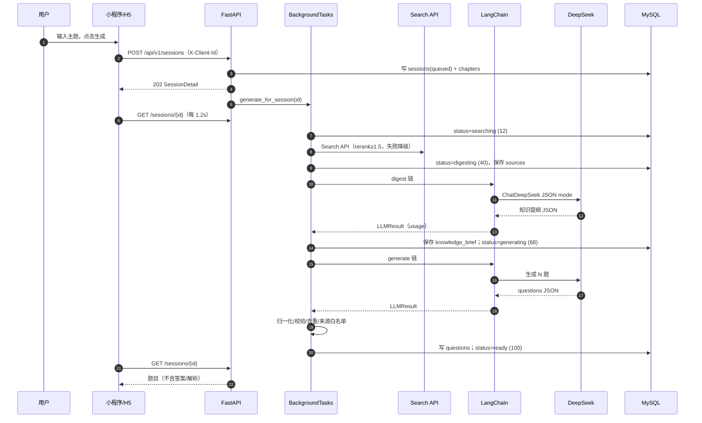
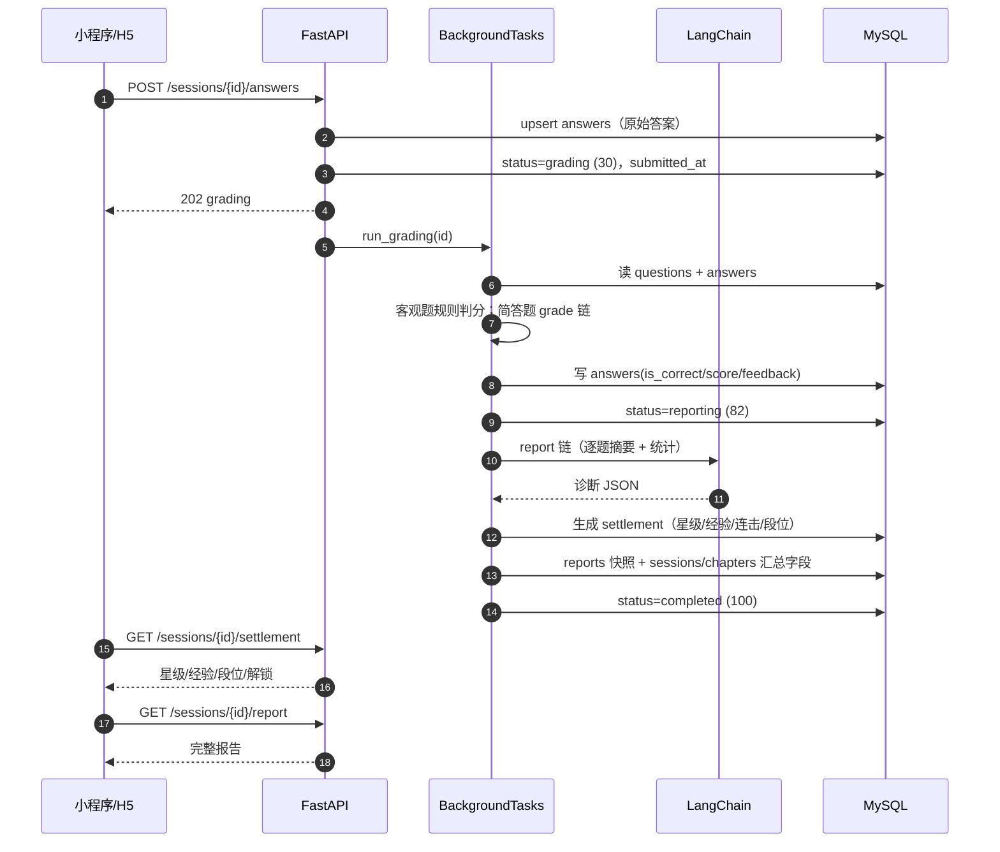
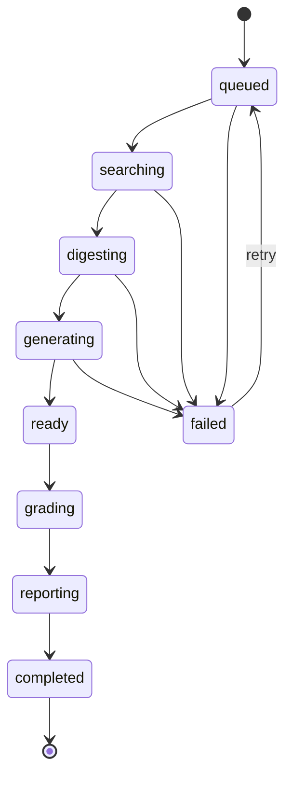

# 08 · 系统架构与代码地图

| 项 | 内容 |
| --- | --- |
| 版本 | v1.0（2026-11-09，对应代码 v0.2.0） |
| 适用 | 后端、前端、测试、接手工程师 |
| 关联 | [方案设计文档](../方案设计文档.md) · [09-API接口手册](./09-API接口手册.md) · [10-数据模型与迁移](./10-数据模型与迁移.md) · [11-前端实现指南](./11-前端实现指南.md) · [12-AI工程与Prompt手册](./12-AI工程与Prompt手册.md) |

> 本文回答三个问题：**系统由哪些层组成、一次学习请求怎么流动、代码在哪里**。接口字段看 09，数据表看 10，Prompt 看 12。

---

## 1. 系统概览

```
┌──────────────────────────────┐
│ 微信小程序 / H5（Taro 4.3.2）│
│ S01–S08 页面、设计系统、轮询   │
└──────────────┬───────────────┘
               │ HTTP JSON + X-Client-Id
┌──────────────▼───────────────┐
│ FastAPI 接入层               │
│ 路由/参数校验/限流/CORS       │
├──────────────────────────────┤
│ 领域服务层                   │
│ 出题编排 / 判分 / 报告 / 结算  │
├──────────────────────────────┤
│ AI 编排层（LangChain 0.3.x）  │
│ ChatPromptTemplate + LCEL     │
├──────────────────────────────┤
│ 适配层                       │
│ ChatDeepSeek / MockChatModel  │
│ Search API（httpx）           │
├──────────────────────────────┤
│ MySQL 仓储层（PyMySQL）       │
└──────────────────────────────┘
```

**技术栈**：Taro 4.3.2 + React 18 + TypeScript；FastAPI 0.115 + Pydantic 2；LangChain 0.3.86 + langchain-deepseek 0.1.4；DeepSeek `deepseek-flash` + Search API；MySQL 8+/9（PyMySQL）。

**运行边界**：无登录。`session_id` 是一次学习的凭证；`client_id` 是匿名设备标识，用于章节/统计隔离。详见 [ADR-018](./04-ADR决策记录.md)。

---

## 2. 分层与职责

| 层 | 目录 | 职责 | 不该做的事 |
| --- | --- | --- | --- |
| 接入层 | `backend/app/api/routes.py` | 路由、参数校验、限流、状态码、BackgroundTasks 派发 | 不写业务规则、不直接调模型 |
| 领域服务 | `backend/app/services/*` | 出题编排、判分、报告、章节、结算、账号、配额 | 不感知 HTTP |
| AI 编排 | `backend/app/chains/*`、`app/prompts.py` | Prompt 模板、LCEL 链、模型调用、JSON/usage 解析 | 不含业务状态 |
| 适配 | `app/llm.py`、`app/llm_types.py`、`app/search.py` | 模型/检索协议、错误映射、Mock 双模式 | 不做业务判断 |
| 存储 | `app/db.py` | MySQL 建表/迁移、CRUD、JSON 序列化 | 不含业务规则 |
| 契约 | `app/schemas.py` | Pydantic 模型、枚举、标签 | 不做 IO |
| 配置 | `app/config.py` | 环境变量、Mock/真实模式判定 | 不放密钥明文 |
| 前端 | `miniapp/src/*` | 页面、组件、请求、轮询、草稿 | 不接触模型 Key |

### 2.1 依赖方向

```
routes → services → (chains | db | search | auth/quota)
                 ↘ schemas / config
```

- `db` 不 import `services`；`services` 不 import `routes`。
- `chains` 只依赖 `config/prompts/llm_types`，不依赖 `db`。
- `llm.py` 是业务层唯一入口，签名稳定为 `run(task, variables, context)`；替换模型不影响业务。

---

## 3. 核心时序

### 3.1 创建会话并出题



**关键不变量**：答题阶段下发 `QuestionPublic`，**永不包含** `correct_answer`/`explanation`。答案只存服务端。

### 3.2 提交答案 → 判分 → 报告 → 结算



### 3.3 失败与重试

```
generate_for_session 任意异常
  → sessions.status=failed, error=中文可读原因
  → 小程序 S07 显示错误卡
  → POST /sessions/{id}/retry
      → 清空 questions/answers/reports
      → status=queued，重新跑生成
      → 成功 ready；仍失败则再次 failed
```

`retry` 只允许 `failed` 状态；其他状态 409。

---

## 4. 状态机

### 4.1 会话状态



| 状态 | progress | 前端页面 | 可用操作 |
| --- | ---: | --- | --- |
| queued | 2 | S07 | 只读/取消 |
| searching | 12 | S07 | 只读/取消 |
| digesting | 40 | S07 | 只读/取消 |
| generating | 68 | S07 | 只读/取消 |
| ready | 100 | S02/S03/S08 | 答题/提交/预览 |
| grading | 30 | S04 等待 | 只读 |
| reporting | 82 | S04 等待 | 只读 |
| completed | 100 | S04/S05 | 看报告/再练 |
| failed | 100 | S07 | 重试/换主题 |

### 4.2 章节节点状态

| 状态 | 条件 | 视觉 | 可点击 |
| --- | --- | --- | --- |
| `done` | 已答/已完成，或 `seq < current_seq` | 苔绿实心 + 勾 | 是（看报告/重玩需新会话） |
| `current` | `seq == current_seq`（ready） | 琥珀 + 外发光 + 数字 | 是（开始） |
| `locked` | `seq > current_seq` 或前置未完成 | 陈纸虚线 + 锁 | 否（toast） |
| `unlocked` | 章末综合满足前 5 关满星 | 琥珀浅底 + 星 | 是（生成综合关） |

**章节进度**：
- `standard`：`total = question_count + 1`（5 题 + 章末综合）
- `daily` / `comprehensive`：`total = question_count`（无章末）
- ready 阶段：`done = current_seq - 1`；completed：题目节点数 + 综合完成数。

---

## 5. 代码地图

### 5.1 后端

```
backend/
├── app/
│   ├── main.py              # FastAPI 入口、CORS、异常兜底、lifespan
│   ├── config.py            # Settings（env/.env）、is_mock/mode
│   ├── schemas.py           # API 契约（Session/Question/Report/Chapter/Profile）
│   ├── db.py                # MySQL 仓储（PyMySQL）、SCHEMA、_migrate、CRUD
│   ├── llm.py               # LLMAdapter：run(task, variables, context)
│   ├── llm_types.py         # LLMResult/LLMError/extract_json/estimate_cost/map_llm_error
│   ├── prompts.py           # ChatPromptTemplate（mustache）+ 常量
│   ├── search.py            # Search API + Mock + rerank≥1.5 过滤
│   ├── utils.py             # letters/is_blank/clamp/overlap_ratio
│   ├── api/routes.py        # REST 端点、登录态、配额、归属校验、限流
│   ├── chains/
│   │   ├── models.py        # ChatDeepSeek 工厂 + MockChatModel
│   │   ├── prompts.py       # PROMPTS 出口
│   │   ├── parsing.py       # AIMessage → LLMResult（usage/cost）
│   │   ├── pipeline.py      # LCEL + 空 content 重试 + 错误映射
│   │   └── mock_data.py     # 四个任务的确定性 Mock 数据
│   └── services/
│       ├── question_gen.py  # 检索→提纲→出题→归一化→入库
│       ├── grading.py       # 客观题规则 + 简答 rubric/降级
│       ├── reporting.py     # 统计 + LLM 教练点评 + settlement + 快照
│       ├── chapters.py      # 章节节点/进度/Profile/连续学习
│       └── settlement.py    # 星级/经验/连击/段位纯函数
├── tests/                   # pytest（43）
├── requirements.txt
├── pytest.ini
└── .env.example
```

### 5.2 前端

```
miniapp/
├── config/                  # Taro webpack5、weapp/h5、设计稿 750、资源 copy
├── src/
│   ├── app.tsx / app.css / app.config.ts
│   ├── config.ts            # API_BASE、轮询参数、storage keys
│   ├── types.ts             # 与后端契约手工对齐
│   ├── services/api.ts      # 请求、Bearer token、X-Client-Id、轮询、草稿、记录
│   ├── services/auth.ts     # 微信/体验登录、退出、登录态恢复
│   ├── hooks/useSafeArea.ts # 状态栏/导航栏/胶囊
│   ├── utils/format.ts      # 时间/答案/问候/主题截断
│   ├── utils/mapLayout.ts   # 由 gen_assets.py 生成的节点坐标
│   ├── styles/              # tokens / components / noise
│   ├── assets/              # icons / mascot / map（SVG）
│   ├── components/          # Icon/Mascot/PageShell/PageHeader/TabBar/...
│   └── pages/
│       ├── index/           # S01 首页
│       ├── map/             # S02 章节地图
│       ├── quiz/            # S03 答题
│       ├── result/          # S04 结算
│       ├── report/          # S05 报告
│       ├── create/          # S06 造关输入
│       ├── generating/      # S07 生成中
│       └── preview/         # S08 预览
└── scripts/                 # e2e / screenshot / seed_demo / gen_assets / serve_h5
```

### 5.3 关键文件索引

| 想改什么 | 先看 |
| --- | --- |
| 新增/修改接口 | `app/api/routes.py` + `app/schemas.py` + 对应 `tests/test_*.py` |
| 新增题型/判分 | `app/services/grading.py` + `app/services/question_gen.py` + `schemas.py` |
| 改 Prompt/模型 | `app/prompts.py` + `app/chains/*` + `tests/test_chains.py` |
| 改章节/星级/经验 | `app/services/chapters.py` + `app/services/settlement.py` + `tests/test_chapters.py` |
| 改页面视觉 | `miniapp/src/styles/tokens.css` + 对应 `pages/*/index.css` |
| 新增页面 | `app.config.ts` + `pages/<name>/` + `PageShell` |
| 改图标/墨团/地图 | `scripts/gen_assets.py` → 重新生成 `src/assets` |
| 改数据库字段 | `app/db.py` 的 `SCHEMA` + `_migrate` + `tests/conftest.py`（MySQL `lwa_test`） |

---

## 6. 关键设计约束

1. **答案不下发**：`QuestionPublic` 无 `correct_answer`/`explanation`；报告和结算才返回。
2. **报告快照**：`reports.payload` 固定，后续题目变化不回写历史。
3. **异步 + 轮询**：创建 202 立即返回；客户端 1.2s 轮询，失败指数退避。
4. **三道校验**：Prompt → JSON parse → Pydantic/业务归一化；非法题丢弃，宁缺毋滥。
5. **Mock/真实同构**：同一条 LCEL 链，只换 `MockChatModel` / `ChatDeepSeek`。
6. **客户端隔离**：章节/统计按 `client_id`；`session_id` 是单次凭证。
7. **可降级**：检索失败用模型知识；简答判分失败用覆盖率；报告 LLM 失败用规则文案。
8. **不引入全局状态库**：页面内 `useState` + 轮询；跨页用 URL 参数。

---

## 7. 与方案设计文档的差异

| 项 | 方案设计 v1.1 | 实现 v0.2.0 | 记录 |
| --- | --- | --- | --- |
| Prompt 编排 | httpx + f-string | LangChain 0.3.x + LCEL | ADR-016 |
| 章节映射 | S02/S08 存在语义冲突 | 一次生成=一章，5 题=5 节点 | ADR-017 |
| 匿名身份 | 仅 session_id | 增加 `client_id` 隔离 | ADR-018 |
| SVG | 内联 SVG | 资源文件 + `<image>` | ADR-019 |
| 页面范围 | 13 页设计 | S01–S08 实现 | 需求/路线图 |

---

## 8. 新增功能的最小路径

以“新增一个只读接口”为例：

1. 在 `schemas.py` 定义响应模型。
2. 在 `db.py` 加仓储函数（参数化 SQL）。
3. 在 `services/*` 组装业务数据（不碰 HTTP）。
4. 在 `routes.py` 加路由、状态码、`_auth`/`_client_id`（如需要）。
5. 在 `tests/` 先写失败用例，再实现。
6. 更新 `docs/09`（接口）与 `docs/05`（测试）或 `CHANGELOG`。
7. 跑 `pytest`、`tsc`、构建、E2E。

> 更多实现细节：[11-前端实现指南](./11-前端实现指南.md)、[12-AI工程与Prompt手册](./12-AI工程与Prompt手册.md)、[13-测试手册](./13-测试手册.md)。