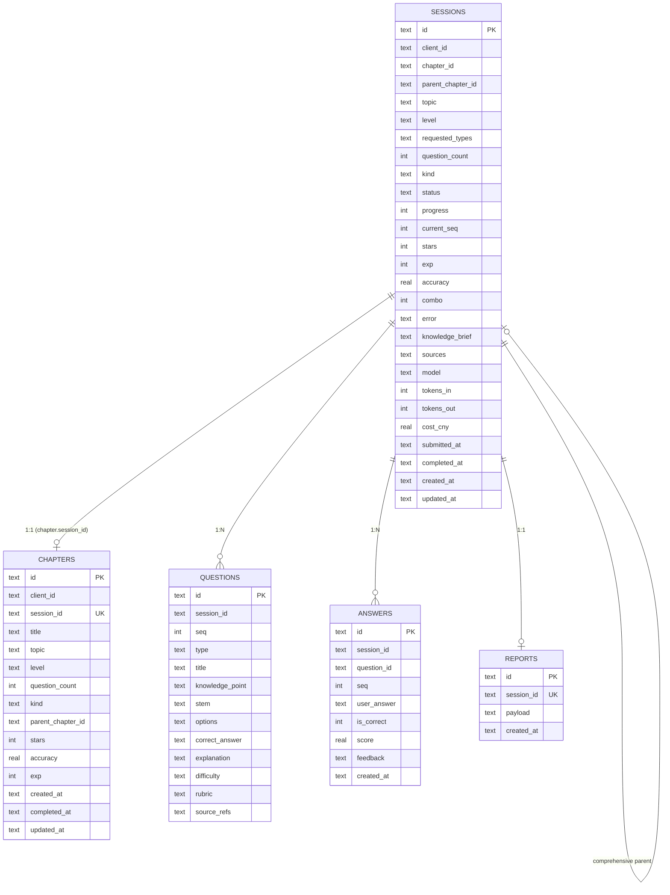
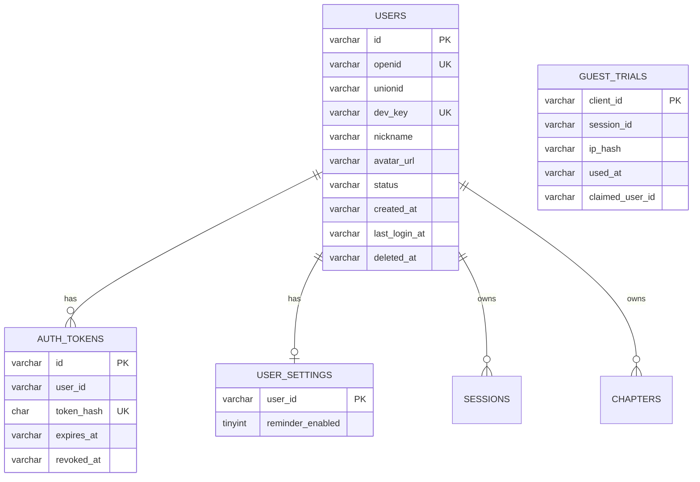

# 10 · 数据模型与迁移

| 项 | 内容 |
| --- | --- |
| 版本 | v1.1（对应后端 v0.3.0） |
| 存储 | **MySQL 8+/9**（PyMySQL，utf8mb4）；开发实例 3307；仓储层 `backend/app/db.py` 隔离 SQL |
| 代码 | `backend/app/db.py`、`backend/app/schemas.py` |
| 关联 | [08-系统架构](./08-系统架构与代码地图.md) · [09-API接口手册](./09-API接口手册.md) |

---

## 1. ER 图



> 说明：SQLite 未启用外键约束；`session_id`/`question_id` 的关系由应用层保证。迁移 PostgreSQL 时建议加 FK 与 `ON DELETE CASCADE`。

---

## 2. 表结构

### 2.1 `sessions`（一次学习 = 一个会话；MVP 同时是“章节”的生成单元）

| 列 | 类型 | 约束/默认 | 说明 |
| --- | --- | --- | --- |
| `id` | TEXT | PK | `s_` + 12 hex |
| `client_id` | TEXT | NOT NULL, `anonymous` | 匿名设备 ID；章节/统计隔离 |
| `chapter_id` | TEXT | nullable | 对应 `chapters.id` |
| `parent_chapter_id` | TEXT | nullable | 章末综合指向原章节 |
| `topic` | TEXT | NOT NULL | 主题 |
| `level` | TEXT | `basic` | basic/advanced/challenge |
| `requested_types` | TEXT | `[]` | JSON 数组 |
| `question_count` | INTEGER | 5 | 实际请求题数（daily 强制 3） |
| `kind` | TEXT | `standard` | standard/daily/comprehensive |
| `status` | TEXT | NOT NULL | 状态机；见 §3 |
| `stage` | TEXT | nullable | 展示阶段（与 status 同步） |
| `progress` | INTEGER | 0 | 0–100 |
| `current_seq` | INTEGER | 1 | 1-based 当前关；用于地图/续答 |
| `stars` | INTEGER | 0 | 章节星级 0–3 |
| `exp` | INTEGER | 0 | 本次经验 |
| `accuracy` | REAL | 0 | 正确率 0–1 |
| `combo` | INTEGER | 0 | 最长连击 |
| `error` | TEXT | nullable | 失败原因（中文） |
| `knowledge_brief` | TEXT | nullable | JSON 提纲 |
| `sources` | TEXT | nullable | JSON 来源数组 |
| `model` | TEXT | nullable | 模型名 |
| `tokens_in/out` | INTEGER | 0 | token 累计 |
| `cost_cny` | REAL | 0 | 估算成本（元） |
| `submitted_at` | TEXT | nullable | 提交答案时间（算用时） |
| `completed_at` | TEXT | nullable | 完成时间 |
| `created_at/updated_at` | TEXT | NOT NULL | UTC ISO 8601 |

**索引**：`idx_sessions_client(client_id, created_at)`（`_migrate` 创建）。

### 2.2 `chapters`

| 列 | 类型 | 约束/默认 | 说明 |
| --- | --- | --- | --- |
| `id` | TEXT | PK | `c_` + 12 hex |
| `client_id` | TEXT | `anonymous` | 归属设备 |
| `session_id` | TEXT | NOT NULL, UNIQUE | 1:1 对应 session |
| `title` | TEXT | NOT NULL | 章节标题（主题前 40 字） |
| `topic` | TEXT | NOT NULL | 主题 |
| `level` | TEXT | `basic` | 难度 |
| `question_count` | INTEGER | 5 | 题数 |
| `kind` | TEXT | `standard` | standard/daily/comprehensive |
| `parent_chapter_id` | TEXT | nullable | 综合关的父章节 |
| `stars/accuracy/exp` | — | 0 | 完成后镜像 session 汇总 |
| `created_at/completed_at/updated_at` | TEXT | — | 时间 |

**索引**：`idx_chapters_client(client_id, created_at)`。

> 为什么单独建 `chapters`：章节列表/个人统计需要按 client 快速查询，且未来可扩展“一章多关”；当前 1:1 由 `session_id UNIQUE` 保证。

### 2.3 `questions`

| 列 | 类型 | 默认 | 说明 |
| --- | --- | --- | --- |
| `id` | TEXT | PK | `q_{session后缀}_{seq}_{rand}` |
| `session_id` | TEXT | NOT NULL | 所属会话 |
| `seq` | INTEGER | NOT NULL | 1-based 题号/节点号 |
| `type` | TEXT | NOT NULL | 四种题型 |
| `title` | TEXT | `''` | 地图节点短名（≤24 字） |
| `knowledge_point` | TEXT | `''` | 知识点全名（≤40 字） |
| `stem` | TEXT | NOT NULL | 题干（≤600 字） |
| `options` | TEXT | `[]` | JSON `[{key,text}]` |
| `correct_answer` | TEXT | `""` | JSON 字符串或数组 |
| `explanation` | TEXT | `''` | 解析（≤800 字） |
| `difficulty` | TEXT | `medium` | easy/medium/hard |
| `rubric` | TEXT | `[]` | 简答得分点 |
| `source_refs` | TEXT | `[]` | 允许的来源 URL |

**索引**：`idx_questions_session(session_id, seq)`。
**安全**：`correct_answer`/`explanation` 只在报告/判分使用，不下发答题接口。

### 2.4 `answers`

| 列 | 类型 | 约束 | 说明 |
| --- | --- | --- | --- |
| `id` | TEXT | PK | `ans_{question_id}` |
| `session_id` | TEXT | NOT NULL | 会话 |
| `question_id` | TEXT | NOT NULL | 题目 |
| `seq` | INTEGER | NOT NULL | 题号 |
| `user_answer` | TEXT | `""` | JSON 字符串/数组 |
| `is_correct` | INTEGER | 0 | 0/1 |
| `score` | REAL | 0 | 0–1（多选/简答可部分分） |
| `feedback` | TEXT | `''` | 批改反馈 |
| `created_at` | TEXT | NOT NULL | 时间 |

**唯一约束**：`UNIQUE(session_id, question_id)`；重复提交用 `ON CONFLICT DO UPDATE`。
**索引**：`idx_answers_session(session_id, seq)`。

### 2.5 `reports`

| 列 | 类型 | 约束 | 说明 |
| --- | --- | --- | --- |
| `id` | TEXT | PK | `rep_{session_id}` |
| `session_id` | TEXT | NOT NULL, UNIQUE | 1:1 |
| `payload` | TEXT | NOT NULL | 完整 `ReportPayload` JSON 快照 |
| `created_at` | TEXT | NOT NULL | 生成时间 |

**为什么存快照**：报告是“当时的结论”，题目/Prompt 后续变化不回写历史；分享/复现稳定。

---

## 3. 状态与派生字段

### 3.1 会话状态

`queued → searching → digesting → generating → ready → grading → reporting → completed`；任一生成阶段可 `failed`；`failed` 可 retry 回 `queued`。

### 3.2 章节节点（不落库，由 `sessions.current_seq` + `questions` + `answers` 派生）

| 状态 | 派生规则 |
| --- | --- |
| done | completed，或 ready 且 `seq < current_seq` |
| current | ready 且 `seq == current_seq` |
| locked | ready 且 `seq > current_seq`；或未生成 |
| unlocked | 章末综合且前 5 关均 3 星 |

### 3.3 汇总字段（冗余换查询速度）

- `sessions.stars/exp/accuracy/combo`：报告生成时写入。
- `chapters.stars/exp/accuracy`：同一时刻镜像。
- `profile`：不落表，按 client 聚合已完成 sessions。
- `stars`：60/80/100 阈值；`exp = correct*20 + stars*20 (+30 daily 全对)`。

---

## 4. 迁移策略

### 4.1 轻量迁移（当前）

`init_db()` 执行 `SCHEMA`（`CREATE TABLE IF NOT EXISTS`）后调用 `_migrate()`：

```python
def _ensure_column(conn, table, column, ddl):
    if column not in {row[1] for row in conn.execute(f"PRAGMA table_info({table})")}:
        conn.execute(f"ALTER TABLE {table} ADD COLUMN {column} {ddl}")
```

- 只加列，不删列/不改类型；向后兼容。
- 旧库自动补 `sessions.client_id/chapter_id/parent_chapter_id/kind/current_seq/stars/exp/accuracy/combo/completed_at` 与 `questions.title/knowledge_point`。
- 旧库补 `idx_sessions_client`。
- 新库由 `SCHEMA` 直接建全量列。

### 4.2 已验证

在 `backend/data/app.db` 副本上执行 `init_db()`，确认：
- `sessions` 新增列存在；
- `chapters` 表创建；
- `questions.title/knowledge_point` 存在；
- 旧数据保留。

### 4.3 新增字段的标准流程（TDD）

1. 在 `SCHEMA` 的新建表定义中加列。
2. 在 `_migrate()` 里加 `_ensure_column`（旧库）。
3. 更新 `create_session/update_session` 等写入函数与 `_loads` 读取。
4. 更新 `schemas.py` 与 `tests/conftest.py`（测试每例新库）。
5. 加一个“旧库迁移”测试或手工副本验证。
6. 更新本文与 `docs/09`。

### 4.4 迁移 PostgreSQL（M4）

| 项 | SQLite | PostgreSQL |
| --- | --- | --- |
| JSON | TEXT + json.dumps | JSONB + GIN（可选） |
| 并发 | 单写/WAL | MVCC |
| 外键 | 未启用 | 建议 FK + CASCADE |
| 索引 | `(session_id, seq)` | 同 + `(client_id, created_at)` |
| 迁移 | `ALTER TABLE ADD COLUMN` | Alembic |
| 时间 | TEXT ISO | `timestamptz` |

仓储函数集中在 `db.py`，业务层不写 SQL；迁移只需替换实现。

---

## 5. 保留、清理与隐私

| 数据 | 保留建议 | 当前实现 |
| --- | --- | --- |
| 匿名会话/题目 | 7 天 | **未实现定时清理**（`MAX_SESSION_AGE_DAYS` 配置存在但未使用） |
| 报告 | 30 天 | 未实现清理 |
| 用户答案 | 30 天 | 未实现清理 |
| IP 日志 | 7 天 | 仅进程日志，无落盘轮转 |
| 昵称/头像 | 不收集 | — |

**注意**：`client_id` 是本地生成的非 PII 标识；报告/答案仍可能包含用户输入，清理任务应在 M4 前补齐。删除接口/用户可请求删除尚未实现。

---

## 6. 备份与恢复

```bash
# 在线备份（WAL 安全）
sqlite3 backend/data/app.db ".backup 'backup-$(date +%F).db'"

# 恢复（停服务后）
cp backup-2026-11-09.db backend/data/app.db
```

- 备份文件不入库（`backend/data/*.db` 已 gitignore）。
- 每日备份 + 保留 7 天；切 PG 后用 `pg_dump`。
- 备份前确认 `-wal/-shm` 状态；`.backup` 会处理一致性。

---

## 7. 已知限制

| ID | 限制 | 影响 | 计划 |
| --- | --- | --- | --- |
| D-01 | 无外键约束 | 孤儿数据可能 | M4 切 PG 时加 FK |
| D-02 | 无定时清理 | 数据无限增长 | M4 清理任务 |
| D-03 | SQLite 单写 | 高并发写锁 | WAL + 短事务；M4 PG |
| D-04 | 报告 JSON 快照不可查询 | 不能按知识点聚合 | 需要时加 `report_items` 表 |
| D-05 | `knowledge_brief` 只读不展示 | 可解释性弱 | P1 报告/预览展示提纲 |
| D-06 | `max_session_age_days` 未使用 | 配置误导 | 清理任务落地时启用 |

---

## 8. 用户系统表（v0.3.0 新增）

> 数据库已从 SQLite 切换为 MySQL。第 1–7 章保留为 v0.2.0 历史说明；当前表结构以 `backend/app/db.py` 的 `SCHEMA` 为准。

### 8.1 ER 补充



### 8.2 新增表

| 表 | 关键列 | 说明 |
| --- | --- | --- |
| `users` | `id`, `openid`, `unionid`, `dev_key`, `nickname`, `avatar_url`, `status`, `deleted_at` | openid 唯一；注销时置 NULL 以允许重新注册 |
| `auth_tokens` | `id`, `user_id`, `token_hash`, `expires_at`, `revoked_at`, `last_used_at` | 只存 SHA-256；默认 30 天 |
| `user_settings` | `user_id` PK, `reminder_enabled` | 学习提醒偏好 |
| `guest_trials` | `client_id` PK, `session_id`, `ip_hash`, `used_at`, `claimed_user_id` | 游客累计 1 组；清缓存/换设备兜底 |

### 8.3 既有表新增列

| 表 | 列 | 默认 | 说明 |
| --- | --- | --- | --- |
| `sessions` | `user_id` | NULL | 登录后数据归属；NULL = 游客 |
| `sessions` | `guest_trial` | 0 | 该会话是否游客试用；不计入登录每日额度 |
| `sessions` | `quota_refunded` | 0 | 生成失败返还标记；重试时清零 |
| `chapters` | `user_id` | NULL | 章节归属 |
| `questions` | `origin_question_id` | NULL | 为后续错题重练预留（本期未启用） |

### 8.4 索引

- `sessions(user_id, created_at)`、`sessions(user_id, created_at, quota_refunded)`：个人记录/额度统计。
- `chapters(user_id, created_at)`：章节列表。
- `auth_tokens(user_id, expires_at)`。
- `guest_trials(client_id)` 主键。

### 8.5 迁移与初始化

```bash
# 本地开发：独立 3307 实例，不碰系统 3306
cd backend
./scripts/start_mysql_dev.sh
```

- 脚本会 `mysqld --initialize-insecure`（首次）+ 创建 `lwa_dev` / `lwa_test` + 用户 `lwa`。
- 生产：`CREATE DATABASE ... utf8mb4 COLLATE utf8mb4_0900_ai_ci;`，创建最小权限账号，配置 `MYSQL_*`；应用启动时 `init_db()` 自动建表/补列。
- 旧 SQLite `backend/data/app.db` 不再读取；不自动迁移，演示数据用 `miniapp/scripts/seed_demo.py` 重建。

### 8.6 备份（MySQL）

```bash
mysqldump --single-transaction --routines --triggers \
  -h 127.0.0.1 -P 3306 -u lwa -p lwa_dev > backup-$(date +%F).sql
# 恢复
mysql -h 127.0.0.1 -P 3306 -u lwa -p lwa_dev < backup-2026-11-10.sql
```

### 8.7 保留与隐私

- 登录用户学习记录：账号存续期；注销后匿名化保留统计。
- 游客记录：建议 30 天清理（待定时任务）。
- 令牌/登录日志：至少 90 天；不记录明文令牌、微信密钥、完整答案。
- 头像文件：`backend/data/uploads/avatars/`；注销后建议清理（当前未自动删除，列入后续）。
