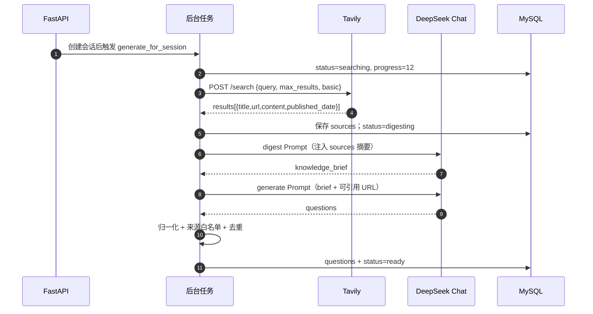

# 21 · 联网搜索实现与验收

| 项 | 内容 |
| --- | --- |
| 版本 | v1.0 |
| 日期 | 2026-11-23 |
| 状态 | 已实现并通过真实 E2E |
| 范围 | AI 造关链路：检索 → 提纲 → 出题 → 判分 → 报告 |
| 关联 | [12-AI工程与Prompt手册](./12-AI工程与Prompt手册.md) · [07-技术核实](./07-技术核实.md) · [09-API接口手册](./09-API接口手册.md) · [14-部署与运维手册](./14-部署与运维手册.md) · [05-测试与验收报告](./05-测试与验收报告.md) |

---

## 1. 背景与结论

原始需求要求「AI 自动从全网或指定信息源获取知识」，并把最新信息注入出题上下文。项目早期已实现 DeepSeek 官方 Search API 适配，但当前 Chat Key 属于阿里云 MaaS 工作区，官方 `api.deepseek.com/v1/tools/search` 返回 401，实际运行一直处于 `ENABLE_WEB_SEARCH=false` 的纯模型知识模式。

本次选择 **Tavily Search API**，与 Chat 网关解耦：

- 当前 MaaS `deepseek-v4.1-flash-1017` 继续负责提纲/出题/判分/报告；
- Tavily 负责真实网页检索，返回标题、URL、摘要、发布日期与相关性分数；
- 检索结果作为「联网检索资料」注入 digest Prompt，再经现有提纲/出题/来源白名单链路落库；
- 检索失败、429、超时或空结果自动降级为纯模型知识，不阻断出题。

**真实 E2E 结论（2026-11-20）**：3 题 ready，6 条真实来源，报告逐题 `source_refs` 非空；Tavily 消耗 1 个 basic credit。

---

## 2. 方案对比

| 方案 | 可用性 | 结构化来源 | 额外 Key | 结论 |
| --- | --- | --- | --- | --- |
| **Tavily Search** | 当前环境可直连 | ✅ `results[].content` + URL + 日期 | 需要 `TAVILY_API_KEY` | **选用** |
| DeepSeek 官方 Search | 当前 Key 401 | ✅ `rerank_score` | 需官方 Key/余额 | 保留适配，不默认 |
| 阿里云 MaaS 内置搜索 | Chat 网关可用 | ⚠️ Chat Completions 不返回来源 | 复用 Chat Key | 不选，来源不可回溯 |
| 纯模型知识 | 始终可用 | ❌ | 无 | 降级兜底 |

Tavily 官方文档（2026-11 核实）：

- Endpoint：`POST https://api.tavily.com/search`
- 鉴权：`Authorization: Bearer tvly-...`；无 Key 可用 `X-Tavily-Access-Mode: keyless`（免费、限流）
- 关键出参：`answer`、`results[{title,url,content,score,published_date}]`、`usage.credits`
- `search_depth=basic` 为 1 credit，`advanced` 为 2 credits

---

## 3. 数据流



关键点：

1. **只取摘要，不取正文**：`include_raw_content=false`，每条摘要截断 800 字，避免 Prompt 膨胀。
2. **一次多拿**：一次请求取 `SEARCH_COUNT`（默认 6）条，符合 Tavily 按请求计费的特点。
3. **来源白名单**：题目 `source_refs` 只能引用本次检索结果中的 URL；模型编造的 URL 会被 `normalize_question` 清空。
4. **失败降级**：检索失败仍进入 digest，Prompt 使用「模型知识」模式，不把整个会话置为 failed。

---

## 4. 代码地图

| 位置 | 职责 |
| --- | --- |
| `backend/app/search.py::TavilySearchClient` | Tavily 请求、鉴权、解析、去重、截断、降级 |
| `backend/app/search.py::get_search` | 按 provider 选择 Tavily / DeepSeek / Noop / Mock |
| `backend/app/config.py::Settings` | `SEARCH_PROVIDER`、Tavily Key/Base URL/深度/超时、provider 解析 |
| `backend/app/services/question_gen.py::generate_for_session` | 检索、保存 sources、注入 digest、生成题目 |
| `backend/app/prompts.py::DIGEST_HUMAN` | 要求优先采用联网资料、冲突以资料为准、优先较新权威内容 |
| `backend/app/services/question_gen.py::normalize_question` | 来源 URL 白名单、去重、长度截断 |
| `backend/app/api/routes.py::health` | 返回真实可用的 `web_search` 与 `search_provider` |
| `backend/tests/test_search_tavily.py` | 请求形状、Bearer/keyless、解析、降级、provider、注入与白名单 |

---

## 5. 配置与运维

### 5.1 最小配置

```bash
ENABLE_WEB_SEARCH=true
SEARCH_PROVIDER=tavily
TAVILY_API_KEY=tvly-xxxxxxxx
TAVILY_ALLOW_KEYLESS=false          # 生产建议 false
TAVILY_SEARCH_DEPTH=basic
TAVILY_TOPIC=general
SEARCH_COUNT=6
```

### 5.2 Provider 行为

| `SEARCH_PROVIDER` | 行为 |
| --- | --- |
| `auto` | 有 `TAVILY_API_KEY` 用 Tavily；否则在非 MaaS 网关上尝试 DeepSeek Search；都不满足则 Noop |
| `tavily` | 强制 Tavily；无 Key 且 `TAVILY_ALLOW_KEYLESS=true` 时使用 keyless |
| `deepseek` | 强制官方 DeepSeek Search（需官方 Key） |
| `none` | 关闭检索，纯模型知识 |

`ENABLE_WEB_SEARCH=false` 时，无论 provider 是什么都关闭检索（Mock 模式例外，仍返回模拟来源）。

### 5.3 生产建议

- 使用正式 Tavily Key，设置 `TAVILY_ALLOW_KEYLESS=false`；
- Key 只放后端 `.env` / 平台 Secret，禁止进入小程序/H5/日志；
- Tavily 429/432/433 时自动降级，监控日志中的 `Tavily 搜索失败 status=...`；
- 关注 `usage.credits`，basic 每次 1 credit，advanced 每次 2 credits；
- 更换 Key 后重启后端即可，无需改代码/数据库。

---

## 6. Prompt 与来源约束

`DIGEST_HUMAN` 新增约束：

1. 优先使用检索资料中的最新信息；
2. 资料与模型知识冲突时，以资料为准；
3. 资料冲突时以官方/一手来源为准；资料不足时才用模型知识，并在 `evidence` 中注明「模型知识」；
4. 资料带发布/更新日期时，优先采用较新的权威内容。

来源约束不变：

- `sources` 中的 URL 必须来自本次检索；
- 题目 `source_refs` 只能取白名单 URL；
- 前端预览/报告只展示真实来源，空来源会显示「本次未联网检索到可用来源」。

---

## 7. 测试与验收

### 7.1 自动化

```bash
cd backend
.venv/bin/python -m pytest -q          # 86 passed
```

新增 `backend/tests/test_search_tavily.py`（9 个用例）：

- 请求路径、Bearer 鉴权、payload 字段；
- 无 Key 时 keyless header；
- 结果解析、URL 去重、空 URL 丢弃、发布日期摘要；
- HTTP 500 / 非 JSON 降级为空来源；
- provider 选择与 `/health` 状态；
- 检索摘要注入 digest；
- 题目 `source_refs` 只保留真实来源，编造 URL 被清空。

### 7.2 真实 E2E

| 项 | 结果 |
| --- | --- |
| 模型 | 阿里云 MaaS `deepseek-v4.1-flash-1017` |
| 检索 | Tavily 正式 Key，HTTP 200，6 条来源，1 credit |
| 会话 | 3 题 ready，无错误 |
| 报告 | sources=6；逐题 source_refs 非空 |
| 前端 | `tsc --noEmit`、weapp/h5 构建、H5 E2E 均通过 |

### 7.3 手工验证

```bash
curl -s http://127.0.0.1:8000/api/v1/health
# 期望：web_search=true, search_provider=tavily

curl -s -X POST http://127.0.0.1:8000/api/v1/sessions \
  -H 'Content-Type: application/json' \
  -H 'X-Client-Id: manual-tavily-check' \
  -d '{"topic":"HTTP 强缓存与协商缓存的区别","level":"advanced","question_count":3,"types":["single_choice","multiple_choice","short_answer"]}'
# 轮询 GET /sessions/{id}，ready 后检查 sources 是否非空
```

---

## 8. 故障排查

| 现象 | 排查 |
| --- | --- |
| `sources=[]`，状态仍 ready | 看后端日志是否 `Tavily 搜索失败`；检查 Key/余额/429；属于预期降级 |
| `/health.web_search=false` | 检查 `ENABLE_WEB_SEARCH`、`SEARCH_PROVIDER`、`TAVILY_API_KEY`；`auto` 无 Key 不会启用 Tavily |
| 401/403 | Key 无效或无权限；重新生成 Key 并重启 |
| 429/432/433 | 额度/限流；等待或升级套餐；可临时 `ENABLE_WEB_SEARCH=false` 退回纯模型 |
| 题目没有来源链接 | 模型没有引用；检查 digest 是否拿到 sources，或 Prompt 是否被改动 |
| 检索很慢 | 使用 `TAVILY_SEARCH_DEPTH=basic`；避免 `advanced`；检查网络 |

---

## 9. 限制与后续

1. 当前只做「出题前检索」，不做多轮对话/追问检索；后者需要会话上下文与流式输出。
2. 不抓取网页正文；若题目需要更细的事实，P1 可接 Tavily Extract 或 DeepSeek Fetch。
3. 来源质量依赖 Tavily 排序；当前不做人工白名单/域名过滤，P1 可加 `include_domains` / 权威度策略。
4. 未接内容审核；上线前仍需 `msgSecCheck` 与 AI 生成标识。
5. keyless 仅适合本地演示；生产必须正式 Key，并监控 credit 消耗。

---

## 10. 变更记录

| 日期 | 变更 |
| --- | --- |
| 2026-11-20 | 接入 Tavily Search；新增 provider 配置、9 个测试、真实 E2E |
| 2026-11-23 | 补充实现文档与文档索引 |