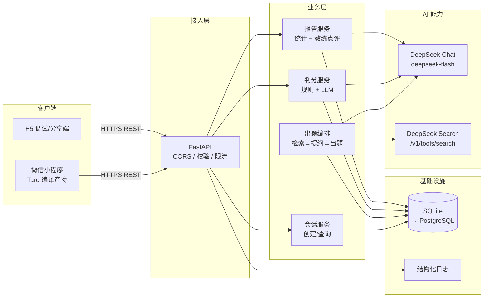
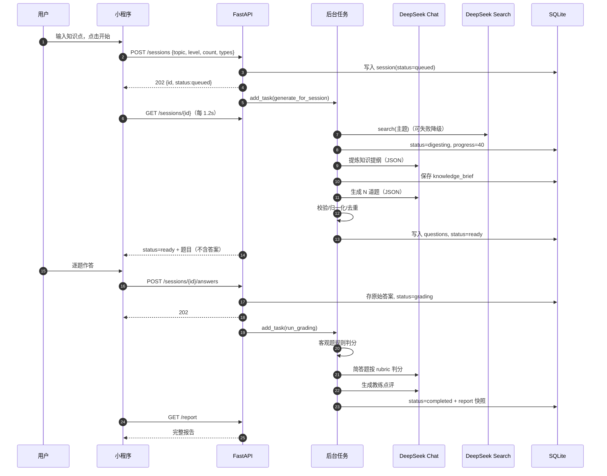
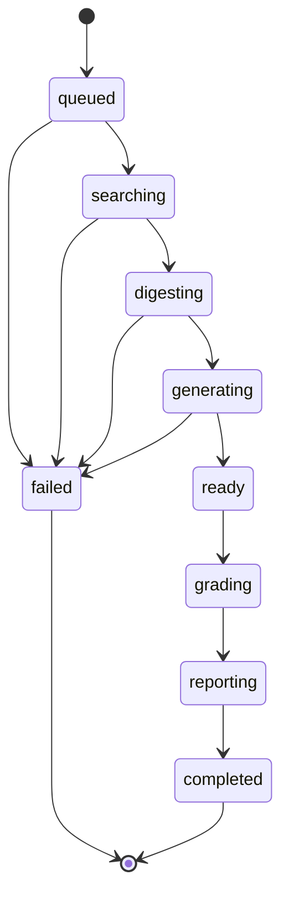
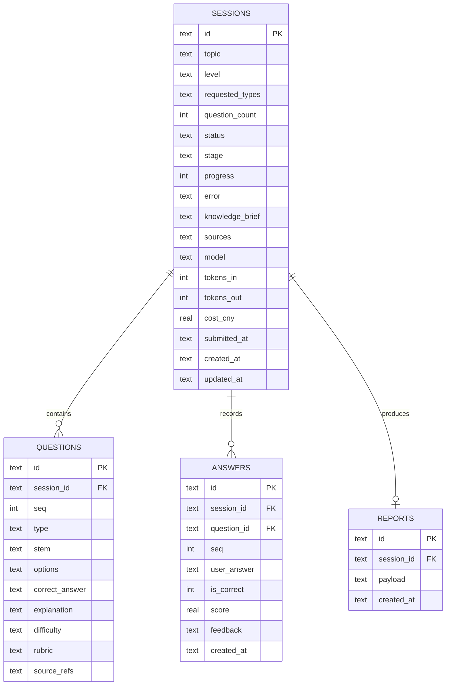
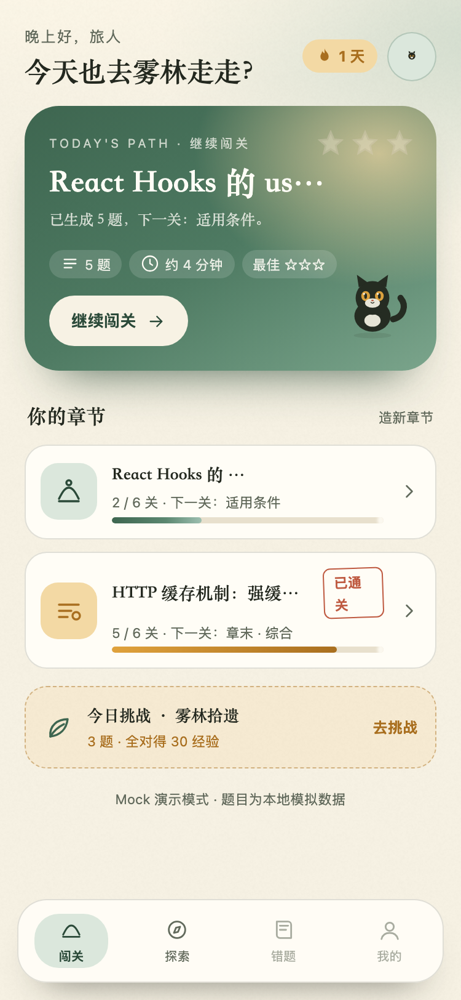
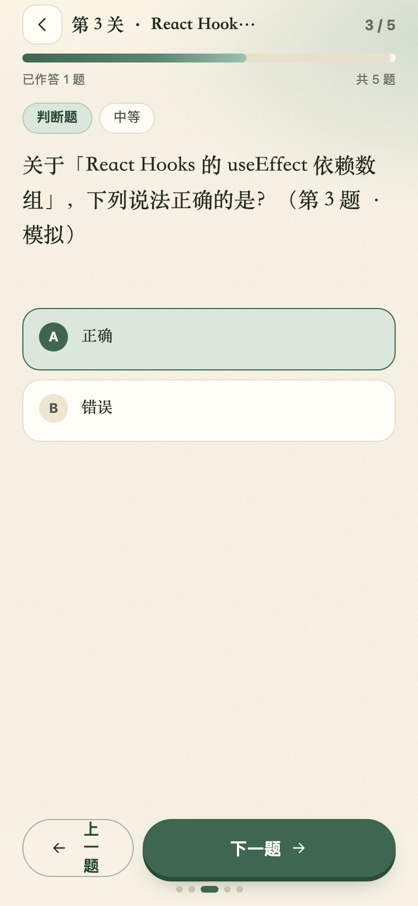
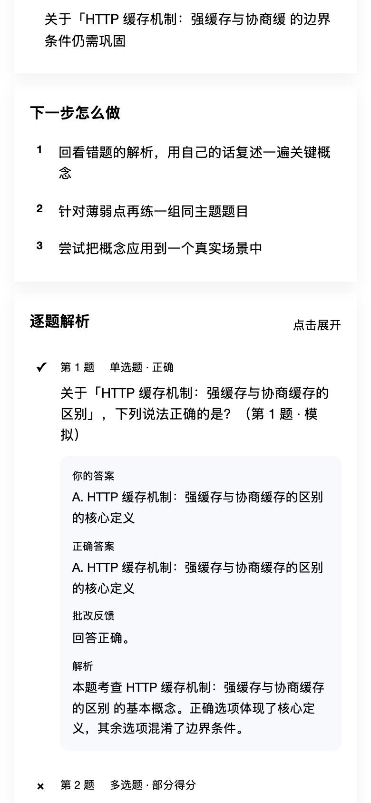
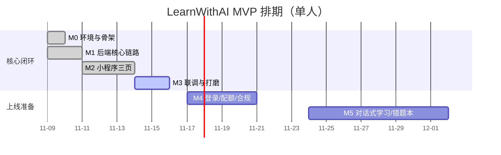

# 《AI 出题学习助手》方案设计文档

| 项目 | 内容 |
| --- | --- |
| 项目代号 | LearnWithAI（产品名：墨灵闯关） |
| 产品形态 | 微信小程序（Taro 多端，含 H5 调试端） |
| 文档版本 | v1.2 |
| 编写日期 | 2026-11-09 |
| 文档状态 | 已确认（技术方案 + MVP 实现 + UI 全案通过；v1.2 实现更新） |
| 关联文档 | [需求分析文档.md](./需求分析文档.md) · [文档中心](./docs/README.md) · [UI 设计规范](./docs/02-UI设计规范.md) · [页面设计说明](./docs/03-页面设计说明.md) |
| 代码位置 | `backend/`（FastAPI）、`miniapp/`（Taro 4.3）、`prototype/`（UI 原型） |
| 目标读者 | 产品负责人、前端/后端开发、未来接手的工程师 |

> 阅读指引：只想快速判断"能不能做、怎么做、多久、多少钱"，看第 0 章和第 3.11 节；要评审技术方案，看第 3～9 章；要接手开发，看第 10、11 章和附录 C；要查 UI 与页面细节，直接去 [docs/](./docs/README.md)。

### 文档版本记录

| 版本 | 日期 | 变更 |
| --- | --- | --- |
| v1.0 | 2026-11-09 | 初版：技术选型、架构、数据模型、接口、AI 工程、开发流程、合规与成本 |
| v1.1 | 2026-11-09 | 接入已确认的 UI 方案（13 页）；补充文档体系、实现差距与迁移计划；同步测试与限制 |
| v1.2 | 2026-11-09 | S01–S08 在 Taro 落地；Prompt 编排切换 LangChain 0.3.x；新增章节/进度/结算/日挑战/章末综合/重试/Profile；45 pytest、双端构建、E2E 通过 |


> **v1.2 实现更新（2026-11-09）**
> - 前端：S01–S08 已按已确认 UI 在 Taro 4.3.2 落地；S09–S13 不在本次范围。
> - AI：Prompt 编排改为 **LangChain 0.3.x（LCEL + ChatDeepSeek）**，详见 [ADR-016](./docs/04-ADR决策记录.md) 与 [docs/07](./docs/07-技术核实.md)。
> - 后端：新增章节/进度/结算/日挑战/章末综合/重试/Profile 接口；45 个 pytest、H5 E2E、weapp/h5 构建通过。
> - 真实 DeepSeek Key 尚未写入 `.env`，真实联调待执行；微信真机、S09–S13、登录/配额/内容审核仍待办。
> - 页面实现细节与显式差异见 [docs/03 第 7.1 节](./docs/03-页面设计说明.md)。
> - 实现文档入口：[08 架构/代码地图](./docs/08-系统架构与代码地图.md) · [09 API](./docs/09-API接口手册.md) · [10 数据模型](./docs/10-数据模型与迁移.md) · [11 前端](./docs/11-前端实现指南.md) · [12 AI 工程](./docs/12-AI工程与Prompt手册.md) · [13 测试](./docs/13-测试手册.md) · [14 部署](./docs/14-部署与运维手册.md) · [15 FAQ](./docs/15-故障排查与FAQ.md)。

## 目录

0. 摘要（TL;DR）
1. 背景与问题定义
2. 用户与场景
3. 技术选型（小程序端横向对比 / 后端 / 模型 / 检索 / 部署）
4. 总体架构
5. 数据模型
6. 接口设计
7. AI 工程
8. 前端设计
9. 安全、合规与隐私
10. 开发流程与思路
11. 部署与运维
12. 成本与商业化
13. 风险登记册
14. 里程碑与验收清单
15. 未来演进
附录 A～D（术语 / 参考 / 交付物 / 需求对照）

---

## 0. 摘要（TL;DR）

**做什么**：用户输入一个想学的知识点，AI 联网检索资料 → 提炼知识提纲 → 生成一组有梯度的题目 → 用户作答 → AI 判分并输出"学习诊断报告"（分数、逐题解析、知识缺口、下一步动作）。核心是把"枯燥的被动阅读"换成"有反馈的主动回忆"。

**技术方案**：

- 前端：**Taro 4.3.2 + React 18 + TypeScript**，一套代码同时产出微信小程序与 H5，先保证微信端体验，H5 用于快速验收与分享。
- 后端：**Python 3.9+ / FastAPI**，异步 IO 天然适配 LLM 的长耗时调用，自动生成 OpenAPI 文档。
- AI：**DeepSeek `deepseek-flash`**（OpenAI 兼容协议、支持 JSON Output），联网检索用 **DeepSeek 官方 Search API**（无需再接 Tavily/Bing）。
- 存储：**SQLite** 起步（零运维），仓储层隔离 SQL，后续平滑迁移 PostgreSQL。
- 部署：**开发期本机；上线推荐 2C4G 轻量云服务器 + Docker + Nginx/Caddy + HTTPS**（用户尚未定，第 3.10 节给出决策矩阵与备选）。

**UI（已确认）**：13 页治愈手绘纸感方案——宣纸底、苔绿主色、琥珀强调、原创猫灵「墨团」，以章节地图承载闯关路径。风格板/线框在 `prototype/`，规范与逐页说明见 `docs/02`、`docs/03`。

**关键设计**：

1. **异步任务 + 状态轮询**，而不是让小程序请求一直挂着。生成一组题需要 10～40 秒，`wx.request` 默认 60 秒上限、弱网下极易超时；改为"创建会话立即返回 → 轮询 status/progress"，同时把等待过程变成可解释的三步进度（检索 → 提炼 → 出题）。
2. **不做登录，先跑通闭环**。用服务端会话 ID 标识一次学习，学习记录存本地缓存；登录/配额/多端同步放到 M4 再补，避免数据库、鉴权、隐私协议阻塞核心验证。
3. **客观题规则判分、主观题 rubric 判分**。客观题零成本零延迟零幻觉；简答题用 LLM 按得分点给分，失败时降级为要点覆盖率算法。
4. **三道校验防脏数据**：Prompt 强约束 → JSON mode → Pydantic + 业务归一化（非法题目直接丢弃，宁缺毋滥）。
5. **Mock 双模式**：没有 API Key 也能完整演示与自动化测试，前后端不被密钥与网络阻塞。

**MVP 成本**：单组 5 题约 **0.03～0.06 元**（flash 模型 + 2 次检索，按官方价估算）；1000 组/月约 50 元 AI 成本 + 100 元服务器。

**MVP 周期**：单人 **7～10 个工作日**。其中核心链路（输入 → 出题 → 答题 → 报告）已在本仓库跑通并通过自动化验收；剩余为体验打磨、登录/配额与上线合规。

---

## 1. 背景与问题定义

### 1.1 原始需求

> 学习之中很容易面临一个问题就是：枯燥。我们可以设计一个小程序，让用户输入用户想学习的内容，让 AI 自动检索内容，生成题库，和用户进行对话式学习。
>
> 核心功能 MVP：
> 1）用户输入详细想要学习的知识。
> 2）AI 自动从全网或者指定的信息源获取知识。
> 3）AI 生成对应的题目。
> 4）用户回答完成之后给出详细的答案和解释。

### 1.2 需求解读：三个真问题

需求原文只有 4 句话，但背后至少有 3 个彼此独立的问题，方案必须分别回答：

| 表层需求 | 真实问题 | 本方案的答案 |
| --- | --- | --- |
| "学习很枯燥" | 缺少**主动回忆**与**即时反馈**，被动阅读留存率低 | 用"出题—作答—批改—报告"制造短反馈回路，把学习变成 3 分钟一局 |
| "AI 自动检索内容" | 模型知识有截止时间、会幻觉，用户不敢信 | 联网检索 + 要求题目引用来源 + 报告展示来源，把"可信"做成可见的产品能力 |
| "对话式学习" | 用户不知道该问什么、问完没有结构 | MVP 先做"结构化提问 + 结构化反馈"；多轮追问作为 P1，在报告页基于错题发起追问 |

### 1.3 产品定位

> **一句话**：把任何一个知识点，在 30 秒内变成一组"刚好适合你"的题，并在答完后告诉你下一步该学什么。

差异化不在于"又一个 AI 问答"，而在于**出题 + 判分 + 诊断**这条闭环：用户不需要会提问，只需要会答题。

### 1.4 目标与非目标（MVP 边界）

**目标（P0，必须做）**

1. 输入任意中文知识点（2～200 字），生成 3～10 道题。
2. 支持单选、多选、判断、简答四种题型，难度分入门/进阶/挑战。
3. 联网检索并展示来源，检索失败可降级为纯模型知识。
4. 作答后给出逐题正误、正确答案、解析、简答点评。
5. 输出学习报告：总分、分题型统计、知识缺口、下一步动作、建议练习主题。
6. 微信小程序 + H5 双端可运行；无 API Key 时可 Mock 演示。

**非目标（MVP 明确不做）**

| 不做 | 原因 | 何时做 |
| --- | --- | --- |
| 账号注册/登录 | 不阻塞核心验证；先验证"生成质量 + 完成率" | M4（微信一键登录 + openid） |
| 支付/会员 | 先有留存再谈变现；iOS 虚拟支付政策需单独评估 | 验证留存后 |
| 多轮对话式追问 | 交互与成本模型都更复杂，先把单轮闭环做扎实 | P1 / M5 |
| 用户自建题库、错题本 | 需要登录与同步能力 | M4 之后 |
| 学习计划、打卡、排行榜 | 与"出题"核心价值无关 | 视留存数据 |
| 多语言 | 目标用户为中文学习者 | 视增长 |

### 1.5 成功指标

| 层级 | 指标 | 定义 | MVP 目标 |
| --- | --- | --- | --- |
| 北极星 | 完赛率 | 创建会话 → 提交答案并看到报告的比例 | ≥ 55% |
| 体验 | 生成成功率 | status=ready 的比例 | ≥ 95% |
| 体验 | 生成耗时 P90 | 创建 → ready | ≤ 45s |
| 质量 | 题目可用率 | 抽检中"无歧义、答案唯一、解析成立"的比例 | ≥ 90% |
| 留存 | 7 日二次学习率 | 7 天内再创建会话的用户占比 | ≥ 25%（早期参考值） |
| 成本 | 单组成本 | AI + 检索费用 | ≤ 0.08 元 |

> 指标口径说明：MVP 无登录，留存以"设备本地 ID + 服务端匿名会话"近似统计；接入登录后切换为 openid。

### 1.6 关键假设与验证方式

| 假设 | 风险 | 验证方式 |
| --- | --- | --- |
| 用户愿意等 20 秒换取个性化题目 | 高（等待是最大流失点） | 进度可视化 + 埋点记录各阶段流失；对比"预生成热门主题"方案 |
| AI 出的题"值得做" | 高（质量决定复购） | 30 条黄金评测集 + 人工抽检；完赛率与重练率 |
| 用户愿意答简答题 | 中（输入成本高） | 对比不同题型配比的完赛率；简答题默认 1 道 |
| 联网检索显著提升可信度 | 中 | A/B：有来源 vs 无来源，观察"报告页停留/来源点击" |

---

## 2. 用户与场景

### 2.1 目标用户

| 画像 | 典型场景 | 核心诉求 | 对方案的含义 |
| --- | --- | --- | --- |
| 备考型（考研/考证/面试） | 通勤、睡前碎片时间刷 5 题 | 覆盖考点、知道哪里不会 | 需要难度分级、知识缺口 |
| 转岗/充电型（程序员、产品） | 学一个新框架/新领域，读完文档记不住 | 快速自测、查漏补缺 | 输入常为技术名词，需检索时效性内容 |
| 兴趣型（人文、科普） | 好奇某个概念，想检验理解 | 低门槛、有趣、不打击信心 | 入门难度 + 鼓励式文案 |

**暂不覆盖**：K12 学科培训（政策与资质敏感）、需要强专业认证的医学/法律结论性内容。

### 2.2 核心用户旅程

```
打开小程序
  → 首页：输入知识点（或点示例）→ 选难度/题量/题型
  → 点击「开始出题」
  → 等待页：检索资料 ✓ → 提炼要点 ✓ → 生成题目（进度条 + 分步说明）
  → 答题页：一次一题，可回退、可跳题，底部圆点显示作答状态
  → 提交：有未答题时二次确认
  → 批改页：AI 批改中（客观题秒判、简答题按要点）
  → 报告页：分数 → 诊断 → 知识缺口 → 下一步 → 逐题解析（可展开）
  → 行动：同主题再练一组 / 换个主题 / 点建议主题继续
```

**情绪设计**：等待段用"AI 正在检索/提炼/出题"降低不确定感；报告页先给结论（分数 + 标签）再给细节，避免用户面对长文；错误态永远给出"重试"而不是死路。

### 2.3 用户故事与验收标准

| ID | 用户故事 | 验收标准（Given / When / Then） |
| --- | --- | --- |
| US-01 | 作为学习者，我想输入任意知识点开始练习 | Given 输入 ≥2 字且 ≤200 字，When 点击开始，Then 202 返回会话并在 45s 内 ready |
| US-02 | 作为学习者，我想知道 AI 在做什么 | Given 生成中，When 停留在等待页，Then 每 1.2s 刷新状态并高亮当前步骤 |
| US-03 | 作为学习者，我想答完看到对错和解释 | Given 提交全部答案，When 批改完成，Then 每题展示我的答案、正确答案、反馈、解析 |
| US-04 | 作为学习者，我想知道自己薄弱在哪 | Given 有错题，When 打开报告，Then 展示 2～4 条具体知识缺口与 2～4 条下一步动作 |
| US-05 | 作为学习者，我想确认 AI 说的有依据 | Given 检索成功，When 展开解析，Then 展示来源链接（可复制） |
| US-06 | 作为开发者，我想没 Key 也能演示 | Given 未配置 DEEPSEEK_API_KEY，When 启动后端，Then 自动 Mock 且全流程可用 |
| US-07 | 作为学习者，我想中途退出后回来还能看 | Given 已有本地记录，When 回到首页，Then 最近学习列表可点开继续 |

### 2.4 功能优先级

| 优先级 | 功能 | 状态 |
| --- | --- | --- |
| P0 | 知识点输入、难度/题量/题型选择 | 已实现 |
| P0 | 联网检索 + 知识提纲 + 出题（四题型） | 已实现 |
| P0 | 答题（单选/多选/判断/简答）、跳题、未答确认 | 已实现 |
| P0 | 规则判分 + rubric 判分 + 逐题解析 | 已实现 |
| P0 | 学习报告（分数/分题型/缺口/下一步/建议主题） | 已实现 |
| P0 | Mock 模式、失败重试、进度可视化 | 已实现 |
| P1 | 微信登录、匿名记录迁移、跨端同步 | 待开发 |
| P1 | 基于错题的多轮追问（对话式学习） | 待开发 |
| P1 | 指定信息源（URL/PDF）导入 | 待开发 |
| P1 | 错题本、间隔重复复习 | 待开发 |
| P2 | 分享卡片、学习成就、排行榜 | 待评估 |
| P2 | 语音答题/朗读、多语言 | 待评估 |

---

## 3. 技术选型（重点）

> 本章是评审重点。小程序生态迭代极快（框架版本、基础库、平台政策），因此选型不追求"最新"，而追求**可维护、可迁移、团队匹配**。本章所有版本号均在 **2026-11-09** 通过 npm registry / 官方文档核实。

### 3.1 选型原则与评分方法

**五条原则**（按优先级）：

1. **先跑通，再优化**：选型必须让核心链路在 1 周内可演示。
2. **可逆性优先**：优先选择"换掉成本低"的方案（如 HTTP 契约、仓储层），避免早期锁死。
3. **团队匹配**：技术栈要能被现有 1～2 人持续维护，招聘成本也要算进去。
4. **AI 编码友好**：2026 年的现实是大量代码由 AI 辅助生成，框架的类型完备度、文档质量、示例密度直接影响交付速度。
5. **合规可行**：能不能过审、能不能备案，比性能多 5% 重要得多。

**评分方法**：加权评分（1～5 分），权重按本项目实际情况设定：

| 维度 | 权重 | 说明 |
| --- | --- | --- |
| 多端能力 | 20% | 未来是否要 H5/支付宝/抖音 |
| 性能与稳定性 | 15% | 首屏、长列表、动画 |
| 生态与组件 | 15% | 组件库、社区案例、问题可搜索性 |
| TypeScript / 工程化 | 15% | 类型、构建、调试、CI |
| 团队匹配 + AI 编码友好 | 15% | React 背景、代码生成准确率 |
| 升级与维护风险 | 10% | 大版本破坏性变更频率 |
| 学习与调试成本 | 10% | 上手速度、报错可读性 |

### 3.2 候选方案与现状

| 方案 | 当前状态（2026-11） | 一句话判断 |
| --- | --- | --- |
| **微信原生**（WXML/WXSS/JS + Skyline/Glass-easel） | 官方主推，基础库持续迭代，Skyline 渲染器可显著提升复杂交互性能 | 体验上限最高，但只能待在微信里 |
| **Taro 4.3.2**（React/Vue，webpack5 / Vite） | 活跃维护，4.x 支持 Vite、鸿蒙、多端；React 生态成熟 | 多端 + React + TS 的最优解之一 |
| **uni-app**（Vue3 + Vite 体系） | 国内生态最大，HBuilderX 一体化，插件市场丰富 | Vue 团队的首选，多端覆盖最广 |
| **微信云开发**（不是端框架，是后端形态） | 云函数/云数据库/云存储，免服务器免备案（默认域名） | 最快上线路径，但绑定微信且 Python 支持弱 |
| **Flutter / React Native** | 非小程序技术，无法直接发布微信小程序 | 本期不考虑，未来做 App 再说 |
| **Wepy / mpvue / Remax** | 已停止维护或边缘化 | 直接排除，不作为候选 |

> 说明：Taro 与 uni-app 都能编译到微信小程序，区别主要在**框架心智、生态、构建链与团队匹配**，而不是"能不能做"。

### 3.3 横向对比（12 个维度）

| 维度 | 微信原生 | Taro 4.3（React） | uni-app（Vue3） |
| --- | --- | --- | --- |
| 跨端能力 | 仅微信（+ 企业微信） | 微信/支付宝/抖音/H5/RN/鸿蒙 | 微信/支付宝/抖音/H5/App/鸿蒙 |
| 开发语言 | WXML/WXSS/JS/TS | React + TSX | Vue3 SFC + TS |
| 类型支持 | 需 miniprogram-api-typings，模板类型弱 | TS 完整（组件/API/页面） | TS 支持好，但模板表达式类型较弱 |
| 构建工具 | 微信开发者工具内置 | webpack5 或 Vite，可接 CI | Vite（CLI 模式） |
| 性能上限 | 最高（Skyline 可 60fps 复杂交互） | 接近原生，运行时有一层适配 | 接近原生，运行时适配层略重 |
| 组件生态 | 官方 + WeUI，第三方较少 | NutUI-React、Taro UI、antd-mobile 可适配 | uni-ui、uView、插件市场最丰富 |
| 调试体验 | 官方工具最完整（WXML 面板、真机调试） | 需看编译产物，跨端报错偶有噪音 | HBuilderX 一体化，真机调试顺 |
| 上手成本 | 低（但 API 面广） | 中（需懂 Taro 生命周期/编译约束） | 低-中（Vue 语法友好） |
| 多端一致性坑 | 无 | 中（样式/生命周期/平台差异） | 中（条件编译可缓解） |
| 升级风险 | 低（官方向后兼容好） | 中（3→4 有破坏性变更） | 中（版本节奏快，npm 包版本号不直观） |
| AI 编码友好度 | 中（模板语法语料少） | 高（React/TS 语料最多） | 高（Vue 语料多） |
| 招聘/外包 | 易（小程序开发普遍） | 中（Taro 经验者较少但 React 可迁移） | 易（Vue 开发者多） |

### 3.4 加权评分

| 方案 | 多端 20% | 性能 15% | 生态 15% | TS/工程 15% | 团队+AI 15% | 升级风险 10% | 调试 10% | **总分** |
| --- | --- | --- | --- | --- | --- | --- | --- | --- |
| 微信原生 | 1 | 5 | 4 | 3 | 4 | 5 | 5 | **3.60** |
| **Taro 4.3 + React** | 5 | 4 | 4 | 5 | 5 | 3 | 3 | **4.30** |
| uni-app + Vue3 | 5 | 4 | 4.5 | 4 | 4 | 3.5 | 4 | **4.22** |

> 分数差异并不悬殊（4.30 vs 4.22 vs 3.60），说明**没有"绝对正确"的框架**。真正的决策变量是：团队是否 React 背景、是否需要多端、是否愿意承担构建链复杂度。

### 3.5 结论：Taro 4.3 + React 18 + TypeScript

**选择理由（按重要性排序）**

1. **一套代码覆盖微信 + H5**：H5 端让"验收、演示、分享、内部评审"不需要每次都开微信开发者工具，也让未来做 Web 版成本趋近于零。
2. **React + TS 的 AI 编码友好度最高**：本项目大量逻辑（状态机、轮询、表单）由 AI 辅助生成，React/TS 的语料密度与类型反馈显著降低返工率。
3. **生态可直接复用**：NutUI-React 等组件库、React 状态管理心智、成熟 hooks 模式都能搬。
4. **构建链可控**：webpack5 稳定，也支持切 Vite；产物是标准小程序包，必要时可逐页迁移回原生。
5. **迁移退路清晰**：Taro 页面本质是 React 组件 + 平台 API，若未来某个页面性能不达标，可以单独用原生实现（Taro 支持混合开发）。

**必须接受的代价（提前说清）**

| 代价 | 具体表现 | 缓解手段 |
| --- | --- | --- |
| 构建链更重 | 首次 `npm install` 约 400MB（本机实测 11 分钟，视网络）；编译产物需排查 | 固定版本、提交 lockfile、CI 缓存 |
| 运行时多一层 | 极复杂动画/长列表不如原生 Skyline | 核心交互保持简单；必要时单页原生化 |
| 跨端差异 | 样式、生命周期、API 在 H5/小程序不完全一致 | 统一用 Taro API；条件编译；双端回归 |
| 升级风险 | 大版本升级可能改配置 | 锁 4.3.x；升级前跑 E2E |

**什么时候应该改选原生**：只有微信端、交互极重（如复杂手势/画布/长列表 60fps）、团队无跨端需求。**什么时候改选 uni-app**：团队是 Vue 背景、需要发 App、依赖插件市场现成轮子。

### 3.6 实测踩坑清单（本次已遇到并解决）

这些问题真实发生过，写进文档避免二次踩坑：

| 现象 | 原因 | 解决 |
| --- | --- | --- |
| `npm install` 报 `EPERM ~/.npm/_cacache` | 沙箱/权限导致全局缓存不可写 | 指定 `NPM_CONFIG_CACHE=$PWD/.npm-cache` |
| Taro 构建报 `EPERM mkdir ~/.taro4.0` | Taro 在 home 写缓存 | 构建时 `HOME=$PWD/.home`（CI/受限环境同理） |
| `Cannot find module '@babel/preset-react'` | babel-preset-taro 的 peer 依赖未自动安装 | 显式安装 `@babel/preset-react`、`@babel/preset-typescript` |
| 小程序请求本机 API 失败 | 开发者工具默认校验合法域名 | 勾选「不校验合法域名」；真机需 HTTPS 域名 |
| H5 请求被浏览器拦 | CORS | 后端 `allow_origins` 配置；生产收敛到具体域名 |
| 长耗时请求超时 | `wx.request` 默认 60s 上限 | 改异步任务 + 轮询（第 4.4 节 ADR-001） |
| 生成 5 题只剩 3 题 | 出题校验把"前 30 字相同"的不同题误判为重复 | 去重指纹改为完整题干归一化（已修复） |

### 3.7 后端框架选型

| 维度 | FastAPI（选中） | NestJS | Spring Boot | 微信云函数 |
| --- | --- | --- | --- | --- |
| 语言/生态 | Python，AI/数据处理生态最强 | Node/TS，与前端同语言 | Java，企业级成熟 | Node 为主 |
| 异步/流式 | 原生 async，SSE/流式简单 | 支持，需额外封装 | 支持，样板代码多 | 受限（常驻进程模型不符） |
| 开发效率 | 高（Pydantic 即校验 + 文档） | 中（装饰器多、样板多） | 低（启动重、配置多） | 中 |
| 类型与契约 | Pydantic → OpenAPI 自动生成 | class-validator | Bean Validation | 弱 |
| 部署体积 | 小（uvicorn 单进程） | 中 | 大（JVM） | 免运维 |
| 适合场景 | AI 编排、MVP、快速迭代 | 全栈 TS 团队、中大型 | 大型企业系统 | 极简、纯微信 |

**结论**：FastAPI。理由：LLM 调用是典型 IO 密集，async 天然合适；Pydantic 同时承担"请求校验 + 模型输出校验"两个职责，正好覆盖 AI 应用最需要的**结构化契约**；Python 也是后续做评测、数据分析、RAG 的自然选择。

**版本策略**：本机 Python 3.9.6 只能装 FastAPI 0.115.x（0.162 起要求 ≥3.10），因此 `requirements.txt` 锁定 0.115.14 + Pydantic 2.9.2。**生产建议 Python 3.12 + FastAPI 最新版**，升级时跑同一套 pytest 即可。

### 3.8 数据库与缓存选型

| 方案 | 优势 | 劣势 | 本项目结论 |
| --- | --- | --- | --- |
| **SQLite** | 零部署、单文件、备份=复制文件 | 并发写弱、无网络访问、迁移成本 | **MVP 选用**（仓储层隔离 SQL） |
| PostgreSQL | 并发/JSON/全文检索强、生态好 | 需运维（或托管） | **生产推荐**（M4 切换） |
| MySQL | 国内托管多、运维熟 | JSON 能力弱于 PG | 备选 |
| Redis | 缓存、限流、队列 | 增加一个依赖 | P1 引入（配额/热点缓存/任务队列） |

**为什么现在不直接上 PostgreSQL**：MVP 阶段 QPS 极低（个人开发者，日活 < 100），SQLite 的 WAL 模式完全够用，且"改一个环境变量就能跑"对验证速度价值更大。代码中所有 SQL 都收敛在 `backend/app/db.py`，迁移时只需替换仓储实现。

### 3.9 AI 模型与检索选型

#### 3.9.1 模型对比

| 模型 | 上下文 | 价格（元/百万 tokens，空闲/高峰） | 特点 | 本项目定位 |
| --- | --- | --- | --- | --- |
| **DeepSeek `deepseek-flash`**（V4.1-Flash-1017） | 1M | 输入（未命中缓存）1 / 2；输出 4 / 8 | 便宜、快、JSON Output、Tool Calls、支持图像理解 | **主力**：出题、判分、报告 |
| DeepSeek `deepseek-v4-pro`（V4-Pro-0813） | 1M | 输入 4.5 / 9；输出 13.5 / 27 | 推理更强、更稳 | **兜底**：难题/评测集/挑战难度 |
| 国内其他（通义/豆包/智谱） | 各异 | 各异 | 备案合规、响应快 | 备选，多供应商容灾 |
| OpenAI / Claude | 各异 | 高 | 质量强，境内访问需代理 | 不用于小程序（合规+网络） |

**选型说明**：

- 出题与判分是"结构化生成"任务，不需要顶级推理能力，`deepseek-flash` 性价比最高；实测单组成本 < 0.06 元。
- 思考模式**默认开启**，必须显式传 `{"thinking": {"type": "disabled"}}` 才关闭（官方文档 2026-11 核实）。关闭后可显著降低延迟与输出 token；本仓库默认 `DEEPSEEK_THINKING=false`，即显式关闭，设为 `true` 时开启 high 强度。注意：思考模式下 `temperature` 等采样参数不生效。
- 使用 `response_format={"type":"json_object"}` 保证 JSON；Prompt 中显式出现 "JSON" 字样（JSON mode 的前置要求）。
- 生产建议：**flash 主 + pro 兜底**（生成校验失败/挑战难度时切 pro），并保留第二家供应商（如通义）做容灾。

#### 3.9.2 检索方案对比

| 方案 | 成本 | 质量 | 接入成本 | 结论 |
| --- | --- | --- | --- | --- |
| **DeepSeek Search + Fetch API** | 5 元/1000 次成功请求 | 自研搜索引擎，返回 `summary`（600～800 字）、`rerank_score`、`authority` | 极低（复用同一 Key） | **选用** |
| Tavily / 博查 / Serper | 约 0.01～0.03 元/次 | 成熟，适合英文 | 需额外 Key 与计费 | P1 备选 |
| Bing / Google CSE | 有免费额度 | 稳定 | 需申请、部分境内不可用 | 不推荐 |
| 自建爬虫 | 服务器+代理成本 | 不可控、易封 | 高 | 不做 |
| 纯模型知识（不检索） | 0 | 时效差、易幻觉 | 0 | **降级兜底**（已实现） |

**关键设计**：Search API 单次返回 `summary` 已足够做知识提炼，默认 `need_content=false` 省 token；只有当某条来源被引用且需要细节时，才调 Fetch API 取正文（QPS 25，注意限速）。

> 计费提醒：Search 按"成功且有结果"的请求计费，`count` 不影响单价；因此**一次多拿几条**（count=6）比多次少量更划算。

### 3.10 部署形态决策（用户尚未定，给出推荐路径）

| 方案 | 月成本 | 运维负担 | 备案 | 适用 | 风险 |
| --- | --- | --- | --- | --- | --- |
| A. 微信云托管（容器） | 按量，低流量约 20～60 元 | 低（免运维、自动扩缩） | 平台默认域名可免备案；绑自有域名需备案 | 不想碰服务器 | 绑定微信生态、冷启动、Python 镜像需自建 |
| **B. 轻量云服务器 2C4G + Docker** | 60～100 元 | 中（自己管系统/证书/备份） | **必须备案**（约 7～20 个工作日） | 长期、可控、可扩展 | 单点故障、需自己监控 |
| C. Serverless 容器（FC/SCF 自定义镜像） | 按量，极低 | 低-中 | 绑域名需备案 | 流量波动大 | 冷启动 1～3s，轮询任务需注意实例回收 |
| D. 微信云开发（云函数+云数据库） | 低 | 最低 | 免备案 | 纯微信、极简后端 | **不适合 FastAPI 常驻进程**，Python 依赖受限 |

**推荐路径**：

1. **开发期（现在）**：本机 `uvicorn` + H5/开发者工具，零成本。
2. **内测期（1～2 周）**：方案 A（云托管）或 C（Serverless 容器），先拿到真实用户反馈，避免被备案卡住。
3. **正式上线**：方案 B。理由：成本可预测、可加 Redis/队列、可做灰度与回滚；备案虽然要等，但一次搞定后长期受益。

**备案与域名清单（方案 B）**：购买域名 → 实名认证 → 提交 ICP 备案（主体+网站）→ 公安备案 → 配置 HTTPS（Let's Encrypt 或云厂商证书）→ 微信公众平台配置 `request`/`uploadFile` 合法域名（必须 HTTPS、已备案、不能带端口）。

### 3.11 选型结论汇总

| 层 | 选型 | 版本/配置 | 决策理由 |
| --- | --- | --- | --- |
| 小程序端 | Taro + React + TypeScript | 4.3.2 / React 18 | 多端 + React 生态 + AI 编码友好 |
| 构建 | webpack5（可切 Vite） | @tarojs/webpack5-runner 4.3.2 | 稳定、文档多 |
| 状态管理 | React hooks + 局部 state | — | 三页应用无需 Redux |
| 后端 | FastAPI + Uvicorn | 0.115.14 / 0.30.6 | 异步、Pydantic 契约、OpenAPI |
| 运行环境 | Python 3.9（本机）/ 3.12（生产） | — | 兼容现有机器，生产升级 |
| 数据库 | SQLite → PostgreSQL | WAL 模式 | 先零运维，后平滑迁移 |
| 模型 | DeepSeek deepseek-flash | OpenAI 兼容 | 成本/质量/JSON 能力平衡 |
| Prompt 编排 | LangChain 0.3.x（LCEL + ChatDeepSeek） | core 0.3.86 / deepseek 0.1.4 | 模板化、可评测、真实/Mock 同构（ADR-016） |
| 检索 | DeepSeek Search API | 5 元/1000 次 | 同一 Key、低接入成本、有摘要 |
| 部署 | 本机 → 云托管/Serverless → 轻量服务器 | Docker + Nginx | 按阶段降低风险 |
| 监控 | 结构化日志 + 自建指标 | — | MVP 够用，P1 接 Sentry |
| 测试 | pytest + Playwright H5 E2E | — | 覆盖契约与主流程 |
---

## 4. 总体架构

### 4.1 架构图



**分层职责**

| 层 | 目录 | 职责 | 不该做的事 |
| --- | --- | --- | --- |
| 接入层 | `app/api/routes.py` | 路由、参数校验、限流、状态码、任务派发 | 不写业务逻辑、不直接调模型 |
| 领域服务 | `app/services/*` | 编排、校验、判分、报告 | 不感知 HTTP |
| AI 适配 | `app/llm.py`、`app/search.py`、`app/prompts.py` | 模型/检索协议、重试、JSON 解析、Prompt | 不含业务状态 |
| 存储 | `app/db.py` | 建表、CRUD、JSON 序列化 | 不含业务规则 |
| 契约 | `app/schemas.py` | Pydantic 模型、枚举、标签 | 不做 IO |

### 4.2 核心时序



### 4.3 会话状态机



| 状态 | 进度 | 客户端表现 | 可执行操作 |
| --- | --- | --- | --- |
| queued | 2 | 展示"准备中" | 只读 |
| searching | 12 | 步骤 1 高亮 | 只读 |
| digesting | 40 | 步骤 2 高亮 | 只读 |
| generating | 68 | 步骤 3 高亮 | 只读 |
| ready | 100 | 渲染题目 | 答题/提交 |
| grading / reporting | 30 / 82 | 批改动画 | 只读 |
| completed | 100 | 报告页 | 看报告/再练 |
| failed | 100 | 错误卡片 | 重试（重新创建） |

### 4.4 关键设计决策（ADR）

| ID | 决策 | 备选 | 理由 | 代价/触发重审 |
| --- | --- | --- | --- | --- |
| ADR-001 | **异步任务 + HTTP 轮询** | 同步长请求 / SSE / WebSocket | 小程序 `wx.request` 上限 60s；同步必然超时。轮询实现最简单、弱网最稳、无长连接成本 | 状态有 1.2s 延迟；QPS 升高后轮询放大请求量 → 改 SSE 或降低频率 |
| ADR-002 | **MVP 不做登录** | 微信一键登录 + JWT | 登录会引入用户表、openid、隐私协议、会话过期，全部不服务于"生成质量"验证 | 无法跨端同步、无法防刷到人；M4 补登录并迁移本地记录 |
| ADR-003 | **客观题规则判分，简答题 LLM** | 全部 LLM 判分 | 客观题规则 0 成本 0 延迟 0 幻觉；LLM 只处理开放答案 | 简答题有成本与波动 → rubric + 降级算法 |
| ADR-004 | **三道校验（Prompt→JSON→Pydantic/归一化）** | 只信 Prompt | 模型输出不可控；必须"不合法就丢弃"，避免脏题进入用户视野 | 可能少于请求题数 → 允许少于 count，最少 1 题；不足时可重试一次 |
| ADR-005 | **SQLite 起步** | 直接 PostgreSQL | 零运维、复制即备份、单文件便于本地复现 | 并发写弱；M4 前迁移 PG（仓储层已隔离） |
| ADR-006 | **Mock 双模式** | 只支持真实 Key | 让前端/测试/演示不依赖密钥与网络 | Mock 数据质量不代表真实效果，需真实联调验收 |
| ADR-007 | **报告存 JSON 快照** | 每次实时聚合 | 报告是"当时的结论"，快照可复现、可分享、查询快 | 题目后续修改不会回写历史报告（可接受） |

---

## 5. 数据模型

### 5.1 ER 图



### 5.2 表结构（与代码一致）

```sql
CREATE TABLE sessions (
  id              TEXT PRIMARY KEY,          -- s_ + 12 位 hex，对外即凭证
  topic           TEXT NOT NULL,
  level           TEXT NOT NULL DEFAULT 'basic',
  requested_types TEXT NOT NULL DEFAULT '[]',-- JSON 数组
  question_count  INTEGER NOT NULL DEFAULT 5,
  status          TEXT NOT NULL,             -- queued..failed
  stage           TEXT,
  progress        INTEGER NOT NULL DEFAULT 0,
  error           TEXT,
  knowledge_brief TEXT,                      -- JSON：提纲
  sources         TEXT,                      -- JSON：检索来源
  model           TEXT,
  tokens_in       INTEGER NOT NULL DEFAULT 0,
  tokens_out      INTEGER NOT NULL DEFAULT 0,
  cost_cny        REAL NOT NULL DEFAULT 0,
  submitted_at    TEXT,                      -- 用于计算答题用时
  created_at      TEXT NOT NULL,
  updated_at      TEXT NOT NULL
);

CREATE TABLE questions (
  id             TEXT PRIMARY KEY,           -- q_{session后缀}_{seq}_{rand}
  session_id     TEXT NOT NULL,
  seq            INTEGER NOT NULL,
  type           TEXT NOT NULL,
  stem           TEXT NOT NULL,
  options        TEXT NOT NULL DEFAULT '[]',
  correct_answer TEXT NOT NULL DEFAULT '""', -- 字符串或数组（简答为要点数组）
  explanation    TEXT NOT NULL DEFAULT '',
  difficulty     TEXT NOT NULL DEFAULT 'medium',
  rubric         TEXT NOT NULL DEFAULT '[]',
  source_refs    TEXT NOT NULL DEFAULT '[]'
);
CREATE INDEX idx_questions_session ON questions(session_id, seq);

CREATE TABLE answers (
  id          TEXT PRIMARY KEY,
  session_id  TEXT NOT NULL,
  question_id TEXT NOT NULL,
  seq         INTEGER NOT NULL,
  user_answer TEXT NOT NULL DEFAULT '""',
  is_correct  INTEGER NOT NULL DEFAULT 0,
  score       REAL NOT NULL DEFAULT 0,
  feedback    TEXT NOT NULL DEFAULT '',
  created_at  TEXT NOT NULL,
  UNIQUE(session_id, question_id)            -- 同一题只能有一份答案
);

CREATE TABLE reports (
  id         TEXT PRIMARY KEY,
  session_id TEXT NOT NULL UNIQUE,           -- 一组题只有一份报告快照
  payload    TEXT NOT NULL,                  -- 完整 ReportPayload JSON
  created_at TEXT NOT NULL
);
```

### 5.3 设计说明

1. **答案与题目分离存储**：`questions.correct_answer` 只在服务端使用；答题阶段下发的 `QuestionPublic` 不含答案与解析字段，从结构上杜绝"抓包看答案"。
2. **JSON 字段而非拆表**：`options/rubric/sources/brief` 都是一次性整体读写的嵌套结构，拆表只会增加 join 与迁移成本；PostgreSQL 阶段可换 `JSONB` 并建 GIN 索引。
3. **报告快照**：报告一旦生成即固定，避免"报告随题目变化"导致的历史不可复现；也方便未来做分享页（按 session_id 只读渲染）。
4. **成本字段内建**：`tokens_in/out` 与 `cost_cny` 直接落在 session 上，便于按天/按主题做成本分析，不需要额外埋点。
5. **索引策略**：MVP 只建了 `(session_id, seq)` 复合索引；报告与答案查询都按 session 收敛，够用。数据量上来后按 `created_at` 建索引做清理任务。
6. **数据保留**：建议匿名会话保留 7 天，报告保留 30 天；定时任务清理（未实现，列入 M4）。

---

## 6. 接口设计

### 6.1 通用约定

| 项 | 约定 |
| --- | --- |
| 协议 | HTTPS + JSON（`Content-Type: application/json`） |
| 前缀 | `/api/v1` |
| 认证 | MVP：无登录，session_id 即凭证；M4：`Authorization: Bearer <token>` |
| 时间 | ISO 8601 UTC（`2026-11-09T11:30:00+00:00`） |
| 错误体 | `{"detail": "中文可读原因"}` |
| 幂等 | 重复提交答案返回 409；创建会话不幂等（每次新会话） |
| 限流 | 按 IP 30 次/小时（可配），超限 429 |

### 6.2 接口清单

| 方法 | 路径 | 说明 | 状态码 |
| --- | --- | --- | --- |
| GET | `/api/v1/health` | 健康检查 + 当前模式（mock/deepseek） | 200 |
| POST | `/api/v1/sessions` | 创建学习会话并触发出题 | 202 |
| GET | `/api/v1/sessions/{id}` | 查询状态/进度/题目（轮询） | 200 / 404 |
| POST | `/api/v1/sessions/{id}/answers` | 提交答案并触发批改 | 202 / 400 / 409 |
| GET | `/api/v1/sessions/{id}/report` | 获取学习报告 | 200 / 409 / 404 |
| GET | `/api/v1/sessions?limit=10` | 最近会话（运维/调试用，未在前端使用） | 200 |

### 6.3 请求/响应示例

**创建会话**

```http
POST /api/v1/sessions
Content-Type: application/json

{
  "topic": "HTTP 缓存机制：强缓存与协商缓存的区别",
  "level": "advanced",
  "question_count": 5,
  "types": ["single_choice", "multiple_choice", "true_false", "short_answer"]
}
```

```json
{
  "id": "s_c60b59ee1e0e",
  "topic": "HTTP 缓存机制：强缓存与协商缓存的区别",
  "level": "advanced",
  "question_count": 5,
  "types": ["single_choice", "multiple_choice", "true_false", "short_answer"],
  "status": "queued",
  "stage": "queued",
  "progress": 2,
  "questions": [],
  "sources": [],
  "answered_count": 0,
  "model": "deepseek-flash",
  "created_at": "2026-11-09T11:30:00+00:00",
  "updated_at": "2026-11-09T11:30:00+00:00"
}
```

**轮询会话（ready）**

```json
{
  "id": "s_c60b59ee1e0e",
  "status": "ready",
  "progress": 100,
  "questions": [
    {
      "id": "q_ee1e0e_1_6c0b",
      "seq": 1,
      "type": "single_choice",
      "stem": "关于 HTTP 强缓存与协商缓存，下列说法正确的是？",
      "difficulty": "easy",
      "options": [
        { "key": "A", "text": "Cache-Control: max-age 命中时不会发起网络请求" },
        { "key": "B", "text": "ETag 属于强缓存" },
        { "key": "C", "text": "强缓存未命中时一定会返回 200" },
        { "key": "D", "text": "协商缓存由 max-age 控制" }
      ]
    }
  ],
  "sources": [
    { "title": "HTTP caching - MDN", "url": "https://...", "site_name": "MDN", "summary": "..." }
  ],
  "answered_count": 0
}
```

> 注意：`questions` 中**没有** `correct_answer` 与 `explanation`，这是安全边界，不是遗漏。

**提交答案**

```http
POST /api/v1/sessions/s_c60b59ee1e0e/answers

{
  "answers": [
    { "question_id": "q_ee1e0e_1_6c0b", "answer": "A" },
    { "question_id": "q_ee1e0e_2_9f2a", "answer": ["A", "C"] },
    { "question_id": "q_ee1e0e_3_71bd", "answer": "B" },
    { "question_id": "q_ee1e0e_4_88cd", "answer": "先定义……再说明机制……最后举例……" }
  ]
}
```

```json
{ "session_id": "s_c60b59ee1e0e", "status": "grading", "progress": 30 }
```

**报告（节选）**

```json
{
  "session_id": "s_c60b59ee1e0e",
  "topic": "HTTP 缓存机制：强缓存与协商缓存的区别",
  "level": "advanced",
  "level_label": "进阶",
  "score": 40,
  "total": 5,
  "correct": 2,
  "accuracy": 0.4,
  "summary": "本次练习正确率 40%，基础概念已建立，但细节与应用还需加强。",
  "level_tag": "建议重学",
  "by_type": { "单选题": { "total": 2, "correct": 1 }, "简答题": { "total": 1, "correct": 0 } },
  "items": [
    {
      "question_id": "q_ee1e0e_1_6c0b",
      "seq": 1,
      "type": "single_choice",
      "type_label": "单选题",
      "stem": "关于 HTTP 强缓存与协商缓存，下列说法正确的是？",
      "options": [{ "key": "A", "text": "..." }],
      "user_answer": "A",
      "correct_answer": "A",
      "is_correct": true,
      "score": 1.0,
      "feedback": "回答正确。",
      "explanation": "max-age 命中时浏览器直接使用本地副本，不发起请求……",
      "rubric": [],
      "source_refs": ["https://..."]
    }
  ],
  "knowledge_gaps": ["第 2 题（多选题）涉及的知识点仍需巩固"],
  "next_steps": ["回看错题的解析，用自己的话复述一遍关键概念", "针对薄弱点再练一组同主题题目"],
  "suggested_topics": ["HTTP 缓存进阶", "HTTP 缓存实战案例"],
  "sources": [{ "title": "HTTP caching - MDN", "url": "https://...", "site_name": "MDN", "summary": "..." }],
  "duration_sec": 63,
  "generated_at": "2026-11-09T11:32:10+00:00",
  "model": "deepseek-flash",
  "usage": { "tokens_in": 9321, "tokens_out": 2874, "cost_cny": 0.0416, "currency": "CNY", "note": "按高峰价保守估算" }
}
```

### 6.4 错误码

| HTTP | 场景 | 前端处理 |
| --- | --- | --- |
| 400 | 无效题目 ID | 提示并允许重新提交 |
| 404 | 会话不存在/已清理 | 引导重新开始 |
| 409 | 题目未生成完 / 已提交 / 报告生成中 | 继续轮询或提示已提交 |
| 422 | 参数校验失败（如主题过短） | 定位到输入框提示 |
| 429 | 触发限流 | 提示休息，稍后再试 |
| 500 | 服务异常 | 通用错误 + 重试 |
| 503 / 超时 | 模型或检索不可用 | 重试；必要时降级纯模型 |

### 6.5 客户端注意事项

1. **域名白名单**：微信公众平台配置 `request` 合法域名，必须 HTTPS、已备案、无端口。
2. **超时设置**：轮询请求 15～30s 足够；创建请求 20s；不要指望单请求等 40s。
3. **重试策略**：轮询失败继续（指数退避可 P1），不要直接判死。
4. **并发控制**：同一 session 只允许一个轮询循环，避免重复请求与状态错乱。
5. **弱网**：请求失败提示"网络不稳定，正在重试"，而非直接报错。

---

## 7. AI 工程

### 7.1 五段式 Pipeline

```
① 检索 Search API（可跳过/降级）
   ↓ 来源列表（title/url/summary/rerank_score）
② 知识提炼 digest（JSON）
   ↓ 提纲：key_points / misconceptions / prerequisites
③ 出题 generate（JSON）
   ↓ 原始题目数组
④ 校验与归一化（Pydantic + 业务规则 + 去重）
   ↓ 可信题目
⑤ 判分 grade（仅简答）+ 报告 report
```

**为什么拆成两次 LLM 调用而不是一次"检索+出题"**：一次调用会让模型在长上下文里同时做"事实整理"和"命题设计"，容易顾此失彼；拆开后，提纲可以被缓存复用、可以人工审阅、也可以作为"知识点覆盖度"的依据。

### 7.2 Prompt 设计要点

Prompt 全部集中在 `backend/app/prompts.py`，与代码解耦、可版本化、可评测。

| 任务 | 关键约束 | 设计意图 |
| --- | --- | --- |
| digest | 只输出 JSON；key_points 4～6 条覆盖定义/机制/应用/边界；资料冲突以一手来源为准；无资料时标注"模型知识" | 把"读资料"变成结构化提纲，降低后续幻觉 |
| generate | 严格题型规范（选项数、答案格式）；干扰项必须"合理但错误"；禁止"以上都对"凑数；解析 60～160 字；source_refs 只能取给定 URL | 用规则约束替代"求模型出好题"的玄学 |
| grade | 按 rubric 给分；同义表达给分；输出 score/correct/feedback/missing_points | 判分可解释、可复算 |
| report | 100～150 字、面向本人、禁止空泛鼓励；缺口必须来自错题 | 让报告"像教练"而不是"像模板" |

**难度分层**（`LEVEL_GUIDE`）：入门 70% 识记 + 20% 应用 + 10% 辨析；进阶 30/50/20；挑战 20/50/30（多步推理与边界）。这不是装饰，而是让"同一主题、不同水平"生成不同认知层级的题。

**JSON mode 细节**：请求体带 `response_format={"type":"json_object"}`，同时 Prompt 中显式出现 "JSON" 字样（DeepSeek JSON mode 的硬性要求）；模型仍可能输出代码块或寒暄，因此解析层做了 `extract_json` 兜底（剥 ```、截取首尾花括号）。

### 7.3 结构化输出与三道校验

| 层 | 做什么 | 失败处理 |
| --- | --- | --- |
| L1 Prompt | 字段、题型、数量、来源白名单 | 模型遵守度靠指令约束 |
| L2 JSON 解析 | `extract_json` 容错解析 | 抛 `LLMError`，session=failed，可重试 |
| L3 Schema + 业务归一化 | Pydantic 校验；选项 key 合法；答案在选项内；多选 ≥2；简答要点 ≥2；题干长度；去重；source_refs 必须来自检索结果 | 单题非法 → 丢弃；全丢 → 失败；少于 count → 允许（附提示） |

**归一化规则**（`services/question_gen.py`）：

- `single_choice`：答案必须是单个字母且在选项中。
- `multiple_choice`：答案为 2 个以上字母、去重排序、全部在选项中。
- `true_false`：强制两个选项为「正确/错误」，答案 A/B。
- `short_answer`：答案转为 3～5 条要点数组，题干外必须有 rubric。
- 难度只允许 easy/medium/hard，非法值回落 medium。
- 题干与选项做长度截断（600 / 200 字），防止异常输出撑爆 UI。

> 这里的取舍是"**宁可少一题，不可错一题**"。对学习产品，一道错题造成的信任损失远大于少一道题。

### 7.4 判分策略

| 题型 | 判分方式 | 部分分 | 说明 |
| --- | --- | --- | --- |
| 单选 / 判断 | 字母精确匹配 | 无 | 0/1 |
| 多选 | 集合比较 | 有：漏选按 `0.5 × 选对数/正确数`，错选 0 | 鼓励"选对但不全"的正向反馈 |
| 简答 | LLM + rubric | 有：0～1 连续分，≥0.6 视为通过 | 提示词要求同义表达给分 |
| 简答降级 | 3 字滑窗覆盖率 | 有：`0.2 + 0.8 × 覆盖率` | LLM 失败时保证"有分可给"，不阻塞报告 |

**为什么简答不直接字符串匹配**：开放答案的表达差异极大，字符串匹配会把正确回答判错，直接摧毁信任。用 rubric 判分 + 降级算法是成本与体验的平衡。

### 7.5 质量评测体系

MVP 没有评测集就等于"感觉还行"，因此设计如下（P1 落地）：

**黄金集**：30 条主题（技术 10、人文 10、考证 10），每条记录：
期望难度、必须覆盖的 3 个知识点、必须避免的常见误解、人工评分的参考答案。

**自动指标**（可脚本化）：

| 指标 | 计算 | 阈值 |
| --- | --- | --- |
| 结构合法率 | 通过三道校验的题数 / 生成题数 | ≥ 95% |
| 答案唯一率 | 人工抽检"是否存在第二个合理解" | ≥ 95% |
| 解析可用率 | 解析能解释"为什么对/为什么错" | ≥ 90% |
| 来源命中率 | 题目 source_refs 非空比例 | ≥ 70%（检索可用时） |
| 难度分布偏差 | 实际 easy/medium/hard 比例与目标差 | ≤ 15% |
| 重复率 | 同会话题干相似度（3-gram Jaccard）> 0.8 视为重复 | ≤ 5% |

**人工评测**：每周抽 20 组，按 1～5 分打分（题干清晰、答案正确、解析有帮助、难度合适），记录 bad case 反哺 Prompt。

**LLM-as-judge**：可用 pro 模型对 flash 生成的题做"是否存在歧义/多解"的二分类复核，成本低，适合上线前批量扫描。

### 7.6 成本测算

按一组 5 题（含 1 道简答）估算：

| 阶段 | 输入 tokens | 输出 tokens | 说明 |
| --- | --- | --- | --- |
| digest | ~4,000 | ~800 | 6～8 条来源摘要 |
| generate | ~2,500 | ~1,800 | 提纲 + 规则 + 5 题 |
| grade（1 道简答） | ~600 | ~200 | rubric 判分 |
| report | ~1,500 | ~500 | 逐题摘要 + 统计 |
| **合计** | **~8,600** | **~3,300** | |

**flash 高峰价**（输入 2 元/M、输出 8 元/M）：`8.6×2/1000 + 3.3×8/1000 ≈ 0.0172 + 0.0264 ≈ 0.044 元`
**检索**：2 次 × 5 元/1000 ≈ 0.01 元
**单组合计**：**约 0.054 元**（空闲时段约 0.032 元；命中上下文缓存更低）

**pro 模型**（9 / 27 元/M）：约 0.077 + 0.089 ≈ 0.17 元/组，用于挑战难度或兜底。

**规模化测算**（flash）：

| 月组数 | AI 成本 | 服务器 | 合计 |
| --- | --- | --- | --- |
| 1,000 | ~54 元 | 80 元 | ~134 元 |
| 10,000 | ~540 元 | 200 元 | ~740 元 |
| 100,000 | ~5,400 元 | 1,000 元 | ~6,400 元 |

> 成本可控的关键：flash 主模型 + 关闭思考 + 检索只取 summary + 客观题零 LLM 判分 + 报告只喂逐题摘要（不喂全文）。

### 7.7 幻觉与内容边界

| 风险 | 手段 |
| --- | --- |
| 事实错误 | 检索来源 + 出题只基于提纲 + 解析要求"可回溯" |
| 编造来源 | `source_refs` 必须在允许 URL 白名单内，否则清空；前端只展示真实来源 |
| 时效性 | Search API 支持 `after:` 语法，可按主题要求近期资料（P1） |
| 超纲/偏题 | Prompt 限定"围绕提纲"，校验时检查题干是否包含主题词（P1） |
| 不当内容 | 服务端 `msgSecCheck` 审核用户输入（M4）；模型侧 system prompt 约束 |
| 医疗/法律等高风险建议 | 报告页加免责声明；此类主题降级为"概念题"（P1） |

---

## 8. 前端设计

> **阅读提示**：8.1～8.7 是 v0 三页功能验证版的历史说明；
> **8.8 是已通过评审的 13 页 UI 方案（UI v1）**。截至 v1.2，**S01–S08 已实现**，实现记录与差异见 [页面设计说明 7.1](./docs/03-页面设计说明.md)。

### 8.1 信息架构与页面流

```
首页 index ──创建会话──▶ 答题页 quiz ──提交──▶ 报告页 report
   ▲                        │                      │
   └──────── 再练/换主题 ────┴──────────────────────┘
```

| 页面 | 路由 | 主要职责 | 关键状态 |
| --- | --- | --- | --- |
| 首页 | `pages/index/index` | 输入主题、选难度/题量/题型、最近学习 | idle / creating / error |
| 答题页 | `pages/quiz/index` | 轮询生成、逐题作答、提交 | generating / ready / submitting / error |
| 报告页 | `pages/report/index` | 等待批改、展示报告、再练 | grading / completed / error |

### 8.2 页面细节

**首页**

- 渐变 Hero（品牌识别）+ 一句话价值主张 + 能力标签。
- 主题输入：`Textarea`，200 字上限、实时计数、示例主题一键填入。
- 难度三选一（入门/进阶/挑战），每个带副标题说明差异。
- 题量 3/5/8；题型多选（至少保留一种）。
- 主 CTA「开始出题」，创建中禁用并提示。
- 最近学习：本地缓存最近 6 组，点击直接进入（已完成则跳报告）。
- Mock 模式时显示「Mock 演示模式」标签，避免误判效果。

**答题页**

- 顶部：主题、题号、进度条、已作答计数。
- 题目卡：题型徽章 + 难度徽章 + 题干 + 选项/简答输入。
- 选项交互：单选/判断点击即选中；多选可反选，提示"选全才得分"。
- 底部：上一题 / 下一题 / 提交答案；最后一题变为提交。
- 圆点导航：当前题加宽、已答题变色，可直接跳题。
- 未答提交：`showModal` 二次确认，说明按 0 分计。
- 生成中：分步进度（检索→提炼→出题）+ 提示语，降低等待焦虑。

**报告页**

- 分数 Hero 按分段变色（≥80 绿、≥60 橙、<60 红），配等级标签。
- 诊断摘要 + 分题型正确率条。
- 知识缺口（来自错题）与下一步动作（编号列表）。
- 逐题解析：默认折叠，点击展开"你的答案 / 正确答案 / 批改反馈 / 解析 / 得分要点 / 来源"。
- 建议主题 chips，点击直接以该主题再练。
- 来源列表可点击复制链接（小程序内不能直接开外链）。
- 底部：换个主题 / 同主题再练一组。
- 页脚展示本次 token 与成本，便于开发者与重度用户感知成本。

**H5 实际截图（Mock 模式，390×844）**

| 输入页 | 答题页 | 报告页 |
| --- | --- | --- |
|  |  |  |

> 截图由 `miniapp/scripts/screenshot.js` 自动生成；Mock 模式下题目带"模拟"标注，真实模式内容由 DeepSeek 生成。

### 8.3 代码结构

```
miniapp/
├── config/                 # Taro 构建配置（weapp / h5 / dev / prod）
├── src/
│   ├── app.tsx             # 应用入口
│   ├── app.config.ts       # 路由与窗口配置
│   ├── app.css             # 设计令牌与通用类
│   ├── config.ts           # API 基址、轮询参数
│   ├── types.ts            # 与后端契约对齐的 TS 类型
│   ├── services/api.ts     # 请求封装、错误、轮询、本地缓存
│   ├── components/
│   │   └── StageLoading.tsx# 生成/失败状态组件
│   └── pages/
│       ├── index/          # 输入页
│       ├── quiz/           # 答题页
│       └── report/         # 报告页
└── scripts/                # 截图与 E2E 脚本（开发工具）
```

**类型契约**：`src/types.ts` 与 `backend/app/schemas.py` 手工对齐。P1 建议由 OpenAPI 自动生成（`openapi-typescript`），彻底消除漂移。

### 8.4 状态管理与数据流

- **不引入 Redux/Zustand**：三个页面、无跨页共享状态，页面内 `useState` + 轮询即可；引入全局状态只会增加样板。
- **跨页传参**：`sessionId` 通过路由参数传递，页面自行拉取完整状态（URL 即状态），刷新/分享后可恢复。
- **本地缓存**：仅缓存"最近学习"列表（id/topic/level/时间），不缓存题目与报告（避免与服务端不一致）。
- **轮询收敛在 service 层**：`pollSession()` 统一超时、错误、回调，页面只消费 `onUpdate`。
- **卸载保护**：`alive` ref 防止页面卸载后 setState 告警；轮询循环在组件卸载后停止。

### 8.5 设计规范

| 令牌 | 值 | 用途 |
| --- | --- | --- |
| 品牌色 | `#4F46E5 → #7C3AED` 渐变 | 主按钮、Hero、进度 |
| 成功 | `#10B981` | 答对、通过 |
| 警告 | `#F59E0B` | 部分分、中等难度 |
| 危险 | `#EF4444` | 答错、错误态 |
| 文本 | `#16181D / #5B6270 / #9AA0AB` | 三级信息层次 |
| 背景 | `#F5F6FA`，卡片 `#FFFFFF` | 层次 |
| 圆角 | 卡片 28px、按钮 999px、选项 20px | 亲和感 |
| 间距 | 8 的倍数（设计稿 750） | 一致性 |

字体使用系统字体栈（PingFang SC / 系统默认），不引入自定义字体，避免小程序包体与首屏负担。

### 8.6 性能与包体

| 事项 | 做法 |
| --- | --- |
| 包体 | 当前小程序主包 < 500KB（远低于 2MB 上限）；引入组件库前先评估体积 |
| 分包 | 页面增多后按"答题/报告"拆分包，主包只留首页 |
| 首屏 | H5 构建 305KB（gzip 后更小）；小程序按需加载 |
| 图片 | 采用纯 CSS 渐变与文字，不依赖图片资源 |
| setData 频率 | 轮询 1.2s 一次，仅更新状态字段；避免整页大对象重渲染 |
| 长列表 | 报告逐题解析折叠渲染，题目 ≤ 10，无长列表压力 |

### 8.7 兼容与降级

- 小程序基础库：Taro 4.3 要求基础库 2.x+；开发工具建议开启"增强编译"。
- H5：现代浏览器；不支持 IE。
- 不支持 `conic-gradient` 等新特性，评分环用"数字 + 线性进度条"替代，兼容性优先。
- 深色模式：MVP 不做，采用固定浅色主题，避免两套样式维护成本。

---

### 8.8 已确认的 UI 方案（UI v1，13 页）

**状态**：2026-11-09 全案通过。风格板与线框见 `prototype/`，逐页说明见 [docs/03](./docs/03-页面设计说明.md)，规范见 [docs/02](./docs/02-UI设计规范.md)。

**设计关键词**：治愈手绘 · 宣纸 · 墨线 · 森林晨雾 · 原创猫灵「墨团」。

| 层 | 决策 |
| --- | --- |
| 主色 | 苔绿 `#3E6650`（行动/已完成） |
| 强调 | 琥珀 `#E0A23C`（当前关/经验/猫瞳），**不作正文** |
| 背景 | 宣纸 `#F7F2E4` / 素笺 `#FFFDF6` |
| 警示 | 朱砂 `#BF5B42`，仅印章/错误/大字 |
| 标题 | Ma Shan Zheng（毛笔）→ 系统楷体回退 |
| 正文 | Noto Serif SC → 系统宋体回退 |
| 吉祥物 | 原创「墨团」：黑猫、毛笔尾、琥珀眼；不使用官方 IP 素材 |

**13 页结构**

| 组 | 页面 | 状态 |
| --- | --- | --- |
| 核心 5 | S01 首页 / S02 章节地图 / S03 答题 / S04 结算 / S05 报告 | **已实现（v0.2.0）** |
| AI 与错题 4 | S06 输入 / S07 生成中 / S08 预览 / S09 错题本 | **S06–S08 已实现**；S09 待实现 |
| 成长社交 4 | S10 成就 / S11 个人中心 / S12 分享 / S13 排行榜 | 设计已确认；均待实现（P1/P2） |

**实现差距与迁移顺序**

1. **M3.1 令牌与组件**：`tokens.css` + 按钮/选项/节点/星级/抽屉，先统一视觉语言。
2. **M3.2 核心换肤 + 结算**：S01/S03/S05 换新视觉，新增 S04。
3. **M3.3 地图与 AI 支线**：S02/S06/S07/S08（需章节与预览接口）。
4. **M3.4 成长线**：S09–S13（需登录、统计、错题、分享、排行接口）。

**兼容策略**：保留旧 3 页路由直到新页面验收通过，用路由灰度切换，不一次性删除可用功能。

## 9. 安全、合规与隐私

> 本节是上线前的硬门槛，不是"以后再说"。MVP 开发期可简化，但**上线前必须逐项打勾**。

### 9.1 小程序类目与资质

| 项 | 建议 | 说明 |
| --- | --- | --- |
| 主体 | 企业主体优先 | 个人主体可做的类目有限，且部分能力（如支付、部分审核接口）受限 |
| 类目 | 工具 → 效率，或 教育 → 教育工具 | **避免**"学科培训/K12 课外辅导"类目：资质门槛高且受政策严格限制 |
| 内容定位 | 成人自主学习工具 | 不做课程售卖、不做押题承诺、不做学科培训 |
| 资质 | 按类目要求补充 | 以微信公众平台**最新**类目要求为准，类目政策变化频繁 |

### 9.2 生成式 AI 合规

| 要求 | 落地动作 |
| --- | --- |
| 使用已备案模型 | 采用 DeepSeek（已完成相关备案）；保留供应商合规材料 |
| 生成内容标识 | 报告页与分享卡片标注「内容由 AI 生成，仅供参考」；图片/文本加显式标识；按《人工智能生成合成内容标识办法》（2025-09-01 施行）执行 |
| 应用侧备案/登记 | 面向公众提供生成式 AI 服务，需按属地网信办要求完成算法/应用登记；**上线前咨询确认** |
| 用户协议与隐私政策 | 小程序内可访问；说明数据用途、AI 生成属性、免责范围 |
| 内容安全 | 用户输入与 AI 输出接入内容安全检测（`msgSecCheck`，服务端调用需 access_token） |
| 未成年人 | 默认面向成人；如涉及未成年人，需监护人同意与青少年模式评估 |

### 9.3 密钥与接口安全

| 风险 | 措施 |
| --- | --- |
| API Key 泄露 | Key 只存后端 `.env`（已 gitignore）；前端永不接触；定期轮换；日志脱敏 |
| 会话被猜解 | session_id 为 12 位 hex（≈2.8×10^14 组合），MVP 可接受；M4 加 openid 归属校验 + HMAC 签名 |
| 接口被刷 | 按 IP 30 次/小时限流；M4 加登录态配额与设备指纹 |
| 越权访问 | 当前按 session_id 即凭证；M4 校验 openid 归属，禁止跨用户读取 |
| 注入 | 参数全部经 Pydantic 校验；SQL 全部参数化（`?` 占位） |
| XSS | 小程序无 DOM；H5 不使用 `innerHTML` 渲染用户内容 |
| 中间人 | 全链路 HTTPS；禁用 HTTP |

### 9.4 数据隐私

| 数据 | 是否收集 | 用途 | 保留 |
| --- | --- | --- | --- |
| 学习主题 | 是 | 生成题目 | 7 天（匿名会话） |
| 答案与得分 | 是 | 判分与报告 | 30 天 |
| 微信昵称/头像 | MVP 不收集 | — | — |
| 手机号 | 不收集 | — | — |
| 设备信息 | 仅服务端日志 IP（限流用） | 防刷 | 7 天 |

**原则**：最小化收集、可删除、不外传、不用于模型训练（DeepSeek API 默认不用于训练，需以官方条款为准）。

### 9.5 内容安全兜底

1. 用户输入：长度限制 + 控制字符清洗 + 敏感词/`msgSecCheck` 预检，命中则拒绝并提示。
2. 模型输出：JSON 结构校验 + 长度截断 + 关键词黑名单；异常内容整题丢弃。
3. 报告文案：禁止绝对化承诺（"保证提分"），统一加免责声明。
4. 举报入口：报告页提供"内容有问题"反馈（P1），进入人工复核队列。

---

## 10. 开发流程与思路（重点）

### 10.1 五条核心原则

1. **垂直切片优先**：每次只做一条"能从输入走到输出"的完整链路，而不是先铺用户系统、再铺页面、最后联调。本项目的第一个切片就是：`输入主题 → 出题 → 答题 → 报告`。
2. **Mock 先行**：AI 依赖是最不确定的一环。先用 Mock 把契约、页面、状态机全部跑通，再切真实模型；这样"没 Key""模型挂了""额度用完"都不会阻塞开发。
3. **契约先行**：先定 Pydantic schema（请求/题目/报告），前后端各自按契约开发，联调时只对字段不对逻辑。
4. **可解释的等待**：长耗时是这类产品的固有成本，必须把等待做成产品的一部分（分步进度 + 文案），而不是一个转圈。
5. **小步可运行**：主干每天可运行；提交粒度小、可回滚；Prompt 改动也要能回归。

### 10.2 为什么"先不做登录注册"

这是本方案最重要的范围决策，理由如下：

| 维度 | 先做登录 | 先做核心链路（本方案） |
| --- | --- | --- |
| 依赖 | 需要用户表、openid、JWT、隐私协议、会话过期 | 零依赖，SQLite 即可 |
| 验证价值 | 不能验证"AI 出的题好不好" | 直接验证生成质量与完赛率 |
| 返工风险 | 登录做完发现产品方向不对，全部白做 | 核心链路是长期资产，登录可后补 |
| 开发时间 | +2～3 天 | 0 |
| 上线阻塞 | 隐私政策、备案、审核前置 | 可先内测 |

**迁移路径（M4）**：`wx.login` 拿 code → 后端换 openid → 签发 JWT → 把本地"最近学习"按 session_id 绑定到 openid → 历史记录跨端可见。数据库只加 `users` 表与 `sessions.user_id` 外键，不动核心逻辑。

### 10.3 阶段规划

| 阶段 | 目标 | 范围 | 产出 | 验收标准 | 工期 | 状态 |
| --- | --- | --- | --- | --- | --- | --- |
| **M0 环境与骨架** | 能跑起来 | 仓库结构、Taro 初始化、FastAPI 骨架、Mock | 双端可启动 | 首页能打开、`/health` 返回 ok | 0.5 天 | ✅ 已完成 |
| **M1 后端核心链路** | 出题到报告闭环 | 检索、提纲、出题、校验、判分、报告、SQLite | REST API + 单测 | pytest 全绿；curl 走通全流程 | 2 天 | ✅ 已完成 |
| **M2 小程序三页** | 用户能完整使用 | 输入页、答题页、报告页、轮询、错误态 | 可交互小程序 | 真机/H5 完成一组题 | 3 天 | ✅ 已完成 |
| **M3 联调与打磨** | 体验达标 | 视觉细节、加载态、边界、真机适配、埋点 | 内测版本 | 双端 E2E 通过；P90 生成 ≤45s | 2 天 | 🔄 进行中 |
| **M4 上线准备** | 可审核发布 | 登录、配额、内容审核、隐私协议、备案、监控 | 线上版本 | 审核通过；错误率 <1% | 4 天 | ⏳ 待开始 |
| **M5 增强** | 提升留存 | 多轮追问、错题本、指定信息源、分享 | 迭代版本 | 留存/完赛率提升 | 5 天+ | ⏳ 待排期 |

**关键路径**：M1 → M2 → M3 → M4。M5 与 M4 可部分并行（如分享卡片不依赖登录）。

### 10.4 每阶段 DoD（Definition of Done）

**通用 DoD**

- [x] 代码通过 `pytest` / `tsc --noEmit` / 双端构建
- [ ] 新增接口有请求/响应示例，并更新文档
- [ ] 错误路径有处理（超时、空数据、非法输入）
- [ ] 无硬编码密钥、无调试日志残留
- [ ] 至少一个人（或 AI 评审）按"用户视角"走一遍

**M1 追加**：真实 Key 与 Mock 两种模式都验证；单组成本可统计。
**M2 追加**：弱网/超时/生成失败三种异常都有可恢复 UI。
**M3 追加**：iPhone + Android 各一台真机；首屏 < 2s；无横向滚动。
**M4 追加**：隐私政策可访问；审核被拒有申诉材料；监控告警可收到。

### 10.5 协作与 Git 流程

| 项 | 约定 |
| --- | --- |
| 分支 | 主干 `main` 始终可发布；功能分支 `feat/xxx`；修复 `fix/xxx` |
| 提交 | Conventional Commits：`feat(quiz): 支持多选题部分分` |
| PR | 小 PR（< 400 行）；描述含"改了什么/怎么验/截图" |
| 版本 | 语义化版本；MVP 阶段 `0.x` |
| 环境 | `.env` 不入库；`.env.example` 入库 |
| 单人开发 | 可简化 PR，但**必须**保留"提交前自测清单" |

### 10.6 质量门禁

| 门禁 | 工具 | 触发 | 当前状态 |
| --- | --- | --- | --- |
| 后端单测/接口测试 | pytest（45 个用例） | 每次提交 | ✅ 已接入 |
| 前端类型检查 | `tsc --noEmit` | 每次提交 | ✅ 已验证通过（`npm run typecheck`） |
| 小程序构建 | `taro build --type weapp` | 每次提交 | ✅ 可运行 |
| H5 构建 | `taro build --type h5` | 每次提交 | ✅ 可运行 |
| H5 E2E | Playwright（`scripts/e2e.js`） | 每日/发布前 | ✅ 已跑通（0 错误/0 404） |
| 视觉截图 | Playwright（`scripts/screenshot.js`） | UI 变更 | ✅ S01–S08 |
| 代码风格 | ruff（后端）、ESLint（前端） | 提交钩子 | ⏳ P1 |
| AI 质量评测 | 黄金集脚本 | Prompt 变更时 | ⏳ P1 |

**建议 CI（GitHub Actions）流水线**：`setup-python` → `pip install` → `pytest` → `setup-node` → `npm ci` → `npm run build:weapp` → `npm run build:h5` → 上传产物。小程序上传用 `miniprogram-ci`（需私钥，放 Secrets）。

### 10.7 测试策略

| 层级 | 覆盖 | 工具 | 说明 |
| --- | --- | --- | --- |
| 单元 | 答案归一化、题干校验、JSON 解析、覆盖率算法 | pytest | 纯函数，快 |
| 接口 | 创建→轮询→提交→报告→异常码 | pytest + httpx ASGITransport | 不启真实端口，CI 友好 |
| E2E | 填主题→出题→逐题作答→报告展开 | Playwright（H5） | 真实浏览器、真实后端 |
| 真机 | 微信开发者工具 + iOS/Android | 手动 | 域名、字体、安全区 |
| AI 质量 | 30 条黄金集 | 脚本 + 人工 | 结构合法率、答案唯一率 |
| 压测 | 并发 50 创建会话 | locust/k6（P1） | 观察 SQLite 锁与模型限流 |

**已执行结果（本次交付）**：

```
pytest:  45 passed
weapp:   Compiled successfully (dist/)
h5:      Compiled successfully (dist-h5/)
E2E:     E2E PASS（375/390/768 无横向溢出；5 题解析；0 错误/0 404）
shots:   S01–S08 共 9 张（shots/）
```

### 10.8 调试手册（高频问题）

| 现象 | 排查顺序 | 解决 |
| --- | --- | --- |
| 小程序请求失败 | 后端是否启动 → 域名是否 HTTPS/备案 → 开发者工具"不校验合法域名" | 本地开发勾选校验开关；线上配合法域名 |
| H5 请求 CORS | Network 面板看预检 → 后端 `allow_origins` | 生产收敛域名，开发放开 |
| 生成一直 queued | 看后端日志 → 是否后台任务异常 | 检查 `.env`、Key、网络；失败会写 error |
| 401/402 | Key 是否有效 → 余额 | 更换 Key / 充值 |
| JSON 解析失败 | 模型是否输出代码块/寒暄 | `extract_json` 已兜底；仍失败则重试/换模型 |
| 返回题目少于请求 | 校验丢弃 | 查看日志中的校验原因；Prompt 加强约束 |
| 报告 409 | 批改未完成 | 先轮询 session，completed 后再取报告（前端已实现） |
| 构建 EPERM | 缓存目录不可写 | 指定 `HOME` / `NPM_CONFIG_CACHE`（见 3.6） |

### 10.9 排期（甘特）



---

## 11. 部署与运维

### 11.1 本地开发

```bash
# 后端
cd backend
python3 -m venv .venv
.venv/bin/pip install -r requirements.txt
cp .env.example .env          # 填入 DEEPSEEK_API_KEY；不填则为 Mock 模式
.venv/bin/uvicorn app.main:app --reload --port 8000
# 接口文档：http://127.0.0.1:8000/docs

# 小程序端
cd miniapp
npm install
npm run dev:weapp             # 产物 dist/，用微信开发者工具打开 miniapp 目录
npm run dev:h5                # H5 调试，默认 10086 端口
```

**微信开发者工具设置**：导入 `miniapp/` 目录（`project.config.json` 已指向 `dist/`），AppID 可用测试号；本地联调勾选「不校验合法域名、web-view（业务域名）、TLS 版本以及 HTTPS 证书」。

### 11.2 生产部署（推荐方案 B）

**Dockerfile（示例）**

```dockerfile
FROM python:3.12-slim
WORKDIR /app
ENV PYTHONDONTWRITEBYTECODE=1 PYTHONUNBUFFERED=1
COPY backend/requirements.txt .
RUN pip install --no-cache-dir -r requirements.txt
COPY backend/app ./app
RUN mkdir -p /app/data
EXPOSE 8000
CMD ["uvicorn", "app.main:app", "--host", "0.0.0.0", "--port", "8000", "--workers", "2"]
```

**docker-compose（示例）**

```yaml
services:
  api:
    build: .
    env_file: .env
    volumes:
      - ./data:/app/data
    ports:
      - "127.0.0.1:8000:8000"
    restart: unless-stopped
```

**Nginx 反向代理（示例）**

```nginx
server {
    listen 443 ssl http2;
    server_name api.example.com;

    ssl_certificate     /etc/letsencrypt/live/api.example.com/fullchain.pem;
    ssl_certificate_key /etc/letsencrypt/live/api.example.com/privkey.pem;

    client_max_body_size 1m;

    location / {
        proxy_pass http://127.0.0.1:8000;
        proxy_set_header Host $host;
        proxy_set_header X-Forwarded-For $proxy_add_x_forwarded_for;
        proxy_read_timeout 180s;   # 覆盖模型最长耗时
    }
}
```

**上线检查清单**

- [ ] 域名备案完成、HTTPS 证书自动续期
- [ ] 微信公众平台配置 request 合法域名
- [ ] `LLM_PROVIDER=deepseek`、Key 写入服务器环境变量（勿写镜像）
- [ ] `cors_origins` 收敛为小程序/自有 H5 域名
- [ ] `--workers` ≥ 2（SQLite 下注意写锁；切 PG 后可提高）
- [ ] 日志落盘 + 轮转；错误告警接入
- [ ] SQLite 每日备份（`sqlite3 app.db ".backup backup.db"`）
- [ ] 限流阈值按真实流量调整
- [ ] 隐私政策、用户协议、AI 生成标识上线

### 11.3 监控与可观测性

| 指标 | 采集方式 | 告警阈值 |
| --- | --- | --- |
| 生成成功率 | 日志统计 status=ready / total | < 95% 告警 |
| 生成耗时 P90 | 日志 duration | > 45s 告警 |
| 模型错误率 | LLMError 计数 | > 5% 告警 |
| 单组 token 成本 | session 表汇总 | 日均 > 预算 120% |
| 接口 5xx | 访问日志 | > 1% 告警 |
| 报告打开率 | 客户端埋点（P1） | 异常下跌 |

**日志规范**：结构化 JSON，字段含 `session_id`、`stage`、`duration_ms`、`tokens`、`error`；**不记录完整用户答案**（隐私），只记长度与得分。

### 11.4 备份、发布与回滚

- 备份：SQLite 每日 `.backup` + 保留 7 天；切 PG 后 `pg_dump` 每日 + WAL 归档。
- 发布：镜像打 tag → 灰度（先 10% 流量）→ 观察 30 分钟 → 全量。
- 回滚：保留上一版镜像，`docker compose up -d --no-deps api:<prev>` 秒级回滚；数据库变更必须向后兼容（先加列，后删列）。
- Prompt 变更视为"代码变更"：需版本号、评测、可回滚。

---

## 12. 成本与商业化（轻量版）

### 12.1 成本结构

| 类型 | 项 | 金额（月） | 说明 |
| --- | --- | --- | --- |
| 固定 | 云服务器 2C4G | 60～100 元 | 方案 B |
| 固定 | 域名 | ~4 元/月 | 50 元/年 |
| 固定 | 小程序认证 | 25 元/月 | 300 元/年（企业） |
| 变动 | 模型 tokens | 0.03～0.06 元/组 | flash，随用量 |
| 变动 | Search API | 0.01 元/组 | 2 次/组 |
| 变动 | 对象存储/流量 | 忽略 | MVP 无图片 |

**盈亏平衡**：若定价 9.9 元/月，单用户每月做 20 组（成本约 1.1 元），毛利率约 89%（不含获客）。

### 12.2 商业化建议（先验证再谈钱）

1. **免费额度**：每日 3 组，覆盖轻度用户，控制成本。
2. **订阅**：9.9 元/月或 68 元/年，不限组数（设每日软上限防滥用）。
3. **单次付费**：1 元/组，适合低频用户。
4. **不做的**：广告（破坏学习体验）、卖课（与工具定位冲突）、押题（合规风险）。
5. **注意**：iOS 小程序虚拟支付政策历史上受限，涉及付费前必须确认最新规则，MVP 不做支付。

---

## 13. 风险登记册

| ID | 风险 | 概率 | 影响 | 应对 | 触发信号 |
| --- | --- | --- | --- | --- | --- |
| R1 | 生成题目质量不稳定（歧义/多解/超纲） | 高 | 高 | 三道校验 + 黄金集 + pro 兜底 + 人工抽检 | 抽检可用率 < 90% |
| R2 | 生成耗时过长导致流失 | 高 | 高 | 异步 + 分步进度 + 预热热门主题 + 缓存 | 等待页跳出率 > 40% |
| R3 | 小程序审核被拒（类目/内容/AI 标识） | 中 | 高 | 提前确认类目、加 AI 标识与免责声明、准备申诉材料 | 首次提审被拒 |
| R4 | 生成式 AI 合规（备案/登记）未完成 | 中 | 高 | 上线前咨询属地网信办；使用已备案模型 | 提审要求补充材料 |
| R5 | API Key 泄露/被盗刷 | 中 | 高 | 仅后端持有、限额、监控异常用量、及时轮换 | 单日费用异常 |
| R6 | 单组成本超预期 | 中 | 中 | flash + 关思考 + 摘要检索 + 限流 + 配额 | 日均成本 > 预算 120% |
| R7 | SQLite 并发写入瓶颈 | 低（MVP） | 中 | WAL + 短事务；提前准备 PG 迁移 | `database is locked` 增多 |
| R8 | 第三方 API 故障 | 中 | 中 | 重试 + 超时 + 降级纯模型 + 多供应商 | 错误率突增 |
| R9 | 用户输入不当内容 | 中 | 中 | 长度/敏感词/`msgSecCheck` + 拒绝策略 | 审核告警 |
| R10 | 无登录导致记录丢失/无法同步 | 高 | 低-中 | 本地缓存 + 明确提示"换设备不同步"；M4 登录 | 用户反馈记录消失 |
| R11 | 数据丢失 | 低 | 高 | 每日备份 + 恢复演练 | 备份失败告警 |
| R12 | 需求蔓延导致延期 | 高 | 中 | 严格 P0 边界；新需求进 Backlog | 迭代范围扩大 |

---

## 14. 里程碑与验收清单

### 14.1 核心链路验收（已完成）

- [x] 输入 2～200 字主题，服务端创建会话并返回 202
- [x] 轮询可见 queued → searching → digesting → generating → ready
- [x] 生成 5 题，覆盖单选/多选/判断/简答，题目不含答案
- [x] 提交答案后客观题规则判分、简答题 rubric 判分
- [x] 报告含分数、分题型统计、逐题解析、知识缺口、下一步、建议主题、来源
- [x] 未答/空答按 0 分处理且有二次确认
- [x] 重复提交返回 409；非法参数 422；不存在 404
- [x] 无 Key 时 Mock 全流程可用
- [x] 微信小程序与 H5 均构建成功
- [x] H5 E2E 全链路通过，控制台无错误
- [x] UI 风格板与 13 页线框通过评审（2026-11-09）

### 14.2 M3 打磨清单（进行中）

**已确认**

- [x] UI 风格与 13 页结构全案通过（2026-11-09）

**UI 实现（详见 docs/03 第 7 节）**

- [x] 设计令牌落地为 `src/styles/tokens.css` / Taro 全局样式（含 rpx 换算）
- [x] 基础组件：按钮、chip、选项、节点、星级、抽屉、空/错状态
- [x] S01 首页 / S03 答题 / S05 报告换新视觉，新增 S04 结算
- [x] S02 章节地图 + S06/S07/S08 AI 造关（章节/预览接口已实现）
- [ ] S09–S13 错题、成就、个人中心、分享、排行（P1/P2）
- [x] 375/390/768 三档无横向溢出；iOS/Android 真机待验收

**体验与质量**

- [x] 生成失败态提供"重试/换个主题"（原位）
- [x] 轮询失败指数退避（1.2s → 5s）
- [x] 首页章节卡显示进度/状态
- [ ] 报告页长文滚动性能与展开动画
- [ ] 埋点：创建/ready/开始答题/提交/报告打开/再练

### 14.3 M4 上线清单（待开始）

- [ ] 微信登录（openid）+ JWT + 本地记录迁移
- [ ] 用户配额（免费 3 组/日）与防刷
- [ ] `msgSecCheck` 内容审核（输入/输出）
- [ ] 隐私政策、用户协议、AI 生成标识、免责声明
- [ ] 类目确认与备案材料
- [ ] 生产环境部署 + HTTPS + 合法域名
- [ ] 监控告警与备份
- [ ] 小程序提审与发布

---

## 15. 未来演进

| 优先级 | 方向 | 价值 | 依赖 |
| --- | --- | --- | --- |
| P1 | **多轮追问（对话式学习）** | 补齐需求原文的"对话式"，错题可追问"为什么" | 会话上下文、SSE 流式、成本控制 |
| P1 | 错题本 + 间隔重复（SM-2） | 从"练一次"到"长期记住"，显著提升留存 | 登录、复习调度 |
| P1 | 指定信息源（URL/PDF/公众号文章） | 满足"指定的信息源"，考试/内部培训场景刚需 | 文件解析、Fetch API、向量检索 |
| P1 | 生成缓存与预生成 | 热门主题秒开，降低延迟与成本 | 主题归一化、缓存键设计 |
| P2 | 分享卡片/学习报告海报 | 低成本获客 | 小程序码、Canvas |
| P2 | 语音答题与朗读 | 降低输入成本，适合通勤 | 语音识别、TTS |
| P2 | 知识图谱与学习路径 | 从单点练习到体系化学习 | 数据积累、图数据库 |
| P2 | 多模型路由 | 质量/成本动态平衡 | 评测体系、供应商接入 |

**对话式学习的产品形态（P1 预设计）**：报告页每道错题下增加「追问」入口 → 进入基于该题上下文的对话（系统提示词带入题干、正确答案、解析、用户答案）→ 支持"换个例子讲""为什么我这个答案不对""再出一道类似的"。技术上复用 `session` 上下文，新增 `POST /sessions/{id}/messages` 与流式返回。

---

## 附录 A. 术语表

| 术语 | 含义 |
| --- | --- |
| 会话（session） | 一次"主题 → 出题 → 答题 → 报告"的完整学习单元 |
| 提纲（brief） | 从检索资料提炼出的结构化知识点，是出题的唯一依据 |
| rubric | 简答题的判分要点/评分细则 |
| JSON mode | 模型强制输出 JSON 对象的接口能力 |
| 降级 | 检索失败用模型知识、LLM 判分失败用覆盖率算法 |
| Mock 模式 | 无 API Key 时用确定性假数据跑通链路 |
| 完赛率 | 创建会话后完成答题并看到报告的比例 |

## 附录 B. 参考资料

| 资料 | 链接 | 用途 |
| --- | --- | --- |
| Taro 官方文档 | https://docs.taro.zone/docs/ | 框架配置、多端、构建 |
| Taro 仓库 | https://github.com/NervJS/taro | 版本与 issue |
| uni-app 文档 | https://uniapp.dcloud.net.cn/ | 选型对比 |
| 微信小程序开发文档 | https://developers.weixin.qq.com/miniprogram/dev/framework/ | 基础库、API、域名 |
| 微信小程序运营规范 | https://developers.weixin.qq.com/miniprogram/product/ | 类目与审核 |
| DeepSeek API 文档 | https://api-docs.deepseek.com/zh-cn/ | 模型、JSON mode |
| DeepSeek 网页搜索与抓取 | https://api-docs.deepseek.com/zh-cn/guides/search | Search/Fetch API |
| DeepSeek 模型与价格 | https://api-docs.deepseek.com/zh-cn/quick_start/pricing | 成本测算 |
| Pydantic 文档 | https://docs.pydantic.dev/ | 数据校验 |
| FastAPI 文档 | https://fastapi.tiangolo.com/ | 后端框架 |
| 生成式人工智能服务管理暂行办法 | 国家网信办等七部门，2023-08-15 施行 | 合规 |
| 人工智能生成合成内容标识办法 | 2025-09-01 施行 | AI 内容标识 |

> 版本核实时间：2026-11-09（Taro 4.3.2、DeepSeek `deepseek-flash` / `deepseek-v4-pro`、价格与 Search API 能力均以当日官方文档为准）。小程序平台政策变化快，上线前需再次核对。

## 附录 C. 本次交付物与运行方式

### C.1 目录结构

```
learning_with_ai/
├── docs/                        # 文档中心（SSOT）
│   ├── README.md                # 文档地图 / 阅读路径 / 维护规则
│   ├── 01-需求规格说明书.md     # FR/NFR、验收、追踪矩阵
│   ├── 02-UI设计规范.md         # 令牌、组件、吉祥物、无障碍
│   ├── 03-页面设计说明.md       # 13 页逐页说明
│   ├── 04-ADR决策记录.md        # 15 条关键决策
│   ├── 05-测试与验收报告.md     # 当前质量快照
│   └── 06-协作与发布指南.md     # 分支/门禁/发布/文档维护
├── prototype/                   # 已确认 UI 原型
│   ├── 00-style-guide.html      # 风格板 + 2 页高保真
│   ├── 01-wireframes.html       # 13 页线框
│   └── README.md
├── 需求分析文档.md              # 原始需求（归档）
├── 方案设计文档.md              # 本文档
├── CHANGELOG.md
├── README.md                    # 快速开始
├── backend/
│   ├── app/
│   │   ├── main.py              # FastAPI 入口 / CORS / 异常处理
│   │   ├── config.py            # 环境变量与模式判定
│   │   ├── schemas.py           # Pydantic 契约
│   │   ├── db.py                # SQLite 仓储层
│   │   ├── llm.py               # LangChain 适配层（对外 run/chat）
│   │   ├── llm_types.py         # LLMResult / JSON 容错 / 错误映射
│   │   ├── search.py            # Search API / Mock（rerank≥1.5）
│   │   ├── prompts.py           # ChatPromptTemplate（mustache）
│   │   ├── utils.py             # 答案归一化等
│   │   ├── api/routes.py        # REST 路由（含章节/进度/结算/Profile）
│   │   ├── chains/              # LangChain：models / prompts / parsing / pipeline
│   │   └── services/
│   │       ├── question_gen.py  # 检索→提纲→出题→校验
│   │       ├── grading.py       # 客观题/简答题判分
│   │       ├── reporting.py     # 统计与报告
│   │       ├── chapters.py      # 章节地图/个人统计
│   │       └── settlement.py    # 星级/经验/连击/段位/连续学习
│   ├── tests/                   # pytest（45 个用例）
│   ├── requirements.txt
│   └── .env.example
├── miniapp/
│   ├── config/                  # Taro 构建配置
│   ├── src/
│   │   ├── pages/{index,map,quiz,result,report,create,generating,preview}/  # S01–S08
│   │   ├── components/          # Icon/Mascot/PageShell/PageHeader/TabBar/StarRating...
│   │   ├── styles/              # tokens.css / components.css / noise.css
│   │   ├── assets/              # icons / mascot / map（由 gen_assets.py 生成）
│   │   ├── hooks/useSafeArea.ts
│   │   ├── utils/{format.ts,mapLayout.ts}
│   │   ├── services/api.ts
│   │   ├── types.ts
│   │   └── app.{tsx,css,config.ts}
│   ├── scripts/{e2e.js,screenshot.js,seed_demo.py,gen_assets.py,serve_h5.py}
│   └── project.config.json
└── shots/                       # S01–S08 验收截图（含 report-full）
```

### C.2 启动命令

```bash
# 1) 后端（无 Key 自动 Mock）
cd backend
python3 -m venv .venv && .venv/bin/pip install -r requirements.txt
cp .env.example .env      # 可选：填入 DEEPSEEK_API_KEY
.venv/bin/uvicorn app.main:app --reload --port 8000

# 2) 小程序
cd miniapp && npm install
npm run build:weapp       # 产物 dist/，微信开发者工具导入本目录
npm run build:h5          # 产物 dist-h5/，可静态托管

# 3) 测试与截图
cd backend && .venv/bin/python -m pytest -q
cd miniapp && npx tsc --noEmit && npm run build:weapp && npm run build:h5
python3 scripts/serve_h5.py dist-h5 10087 &
node scripts/e2e.js
SQLITE_PATH=../backend/data/app.db ../backend/.venv/bin/python scripts/seed_demo.py --reset
node scripts/screenshot.js
```

### C.3 环境变量

| 变量 | 默认 | 说明 |
| --- | --- | --- |
| `LLM_PROVIDER` | `auto` | auto/deepseek/mock |
| `DEEPSEEK_API_KEY` | 空 | 为空则 Mock |
| `DEEPSEEK_MODEL` | `deepseek-flash` | 可切 `deepseek-v4-pro` |
| `DEEPSEEK_THINKING` | `false` | 是否开启思考模式 |
| `ENABLE_WEB_SEARCH` | `true` | 是否联网检索 |
| `SQLITE_PATH` | `./data/app.db` | 数据库路径 |
| `RATE_LIMIT_PER_HOUR` | `30` | 每 IP 每小时创建上限 |
| `MONTHLY_QUOTA` | `10` | 个人中心展示的月度 AI 造关额度（当前仅展示） |

### C.4 已知限制（诚实清单）

1. **无登录**：换设备不同步；session_id 即凭证，安全性为 MVP 级。
2. **限流为进程内内存**：多实例部署会失效，需 Redis（P1）。
3. **SQLite 单写**：高并发下可能 `database is locked`，需迁移 PG。
4. **Mock 数据固定**：Mock 只验证链路，不代表真实生成质量。
5. **微信原生能力未用**：未接微信登录、订阅消息、分享、客服。
6. **未接内容审核**：上线前必须补 `msgSecCheck`。
7. **报告不持久化到用户维度**：匿名数据 7～30 天后清理。
8. **未做流式输出**：等待体验靠进度条弥补，流式在 P1。
9. **S09–S13 尚未实现**：S01–S08 已按 UI v1 落地；S09–S13 在 `prototype/` 与 `docs/03` 待开发。
10. **真实模型未联调**：`.env` 尚未配置 Key；ChatDeepSeek 请求形状已用 MockTransport 测试，真实成本/耗时待校准。
11. **文档与代码可能短暂漂移**：以 `docs/` 为事实来源，发现不一致先改文档再改代码。

## 附录 D. 需求 → 设计 → 代码对照表

| 需求条目 | 设计章节 | 代码位置 | 状态 |
| --- | --- | --- | --- |
| 1）用户输入想学的知识 | 2.2 / 8.2 | `miniapp/src/pages/index/index.tsx` | ✅ |
| 输入校验与长度限制 | 10.6 / 6.4 | `backend/app/schemas.py`（`SessionCreate`） | ✅ |
| 2）AI 自动从全网获取知识 | 3.9.2 / 7.1 | `backend/app/search.py`、`app/services/question_gen.py` | ✅ |
| 检索失败降级 | 7.7 | `question_gen.py` 捕获异常后继续 | ✅ |
| 3）AI 生成题目 | 7.1～7.3 | `app/prompts.py`、`question_gen.py` | ✅ |
| 题目结构化校验 | 7.3 | `normalize_question` / `validate_questions` | ✅ |
| 4）答题后给出答案和解释 | 7.4 / 8.2 | `grading.py`、`reporting.py`、`report/index.tsx` | ✅ |
| 学习报告与下一步建议 | 7.1 / 8.2 | `reporting.py`（含 LLM 失败回退） | ✅ |
| 对话式学习 | 15（P1） | 待开发 | ⏳ |
| 指定信息源 | 15（P1） | 待开发 | ⏳ |
| 登录/多端同步 | 10.2 / 10.3（M4） | 待开发 | ⏳ |
| 成本可控 | 7.6 / 12.1 | `llm.py` 计费函数 + `sessions.cost_cny` | ✅ |
| 合规与内容安全 | 9 | 部分实现（免责文案待补） | 🔄 |

> 页面级对照见 [docs/03 第 6 节](./docs/03-页面设计说明.md)；完整需求追踪矩阵见 [docs/01 第 11 节](./docs/01-需求规格说明书.md)。
